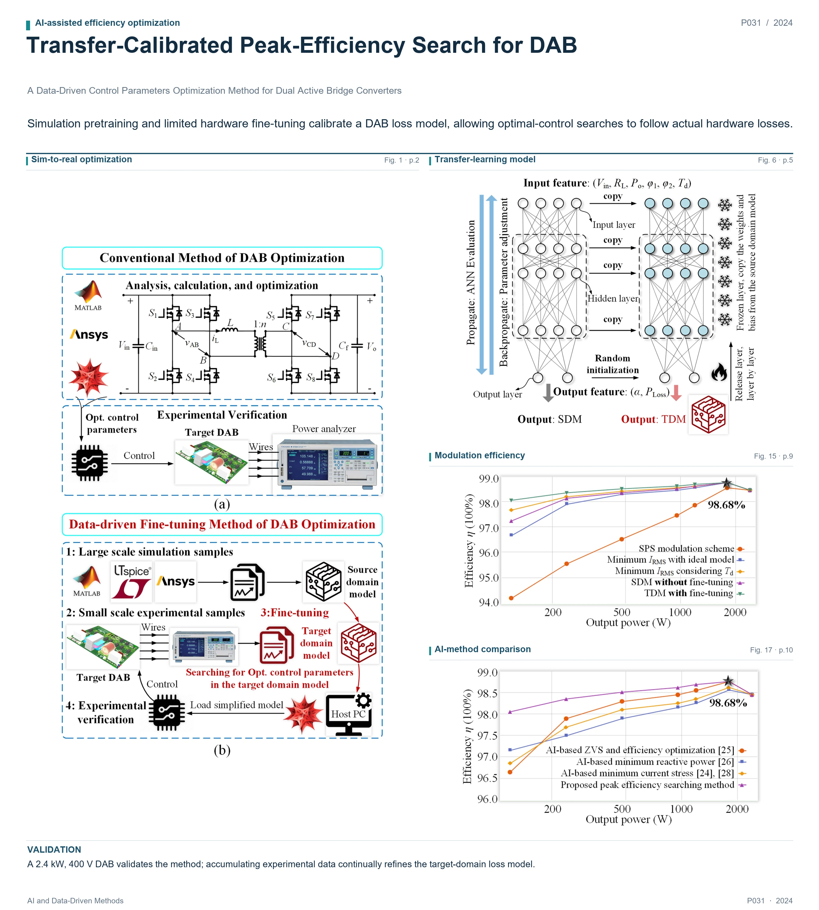

## Abstract

Conventional optimization approaches for dual active bridge converters (DAB) involve separate analysis and experimental verification stages, which may lead to suboptimal experiment results due to unaccounted parameters. This article presents a data-driven control parameters optimization method for DAB. The theoretical analysis and experimental verification of power loss serve as the source and target domains, respectively. By employing a large-scale set of simulation samples, we train an artificial neural network to evaluate power loss under various operating conditions. The insights gleaned from the pretrained source domain model are subsequently transferred to a target domain model (TDM) through transfer learning fine-tuning on a small scale of experiment samples. The TDM is utilized within a mathematical software to explore optimal control parameters, striking a balance between precision and calculation complexity. Experimental results from a 2.4-kW 400-V DAB prototype demonstrate that the proposed peak efficiency searching method progressively enhances the accuracy of the power loss model through the accumulation of experimental data. Outperforming conventional AI-based optimization methods, our approach utilizes a TDM based on real-world experimental data, effectively guiding the search for optimal control parameters, and ensuring the attainment of actual peak efficiency.

<figure id="research-figure" class="publication-figure">
  
</figure>
