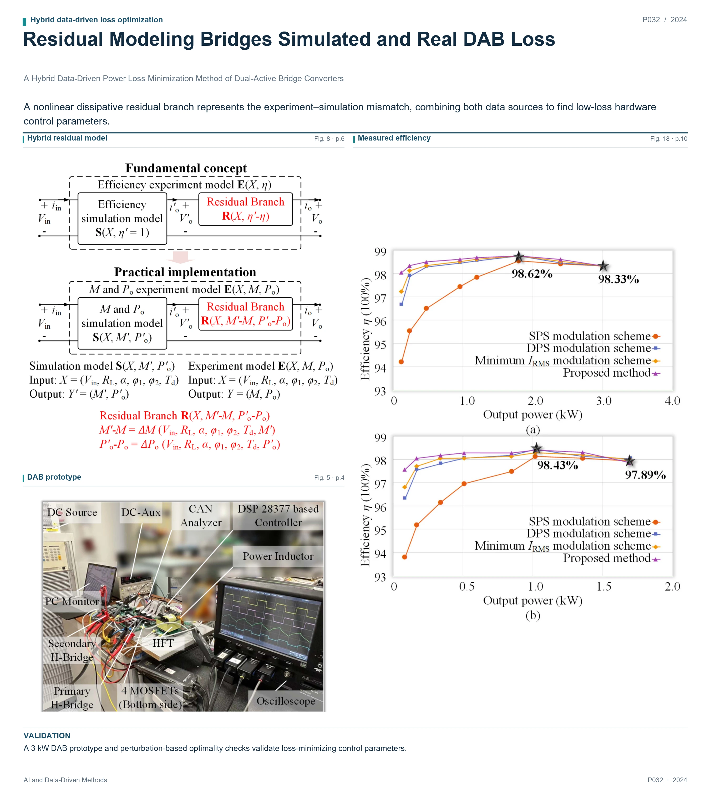

## Abstract

Due to the intricate array of control parameters, achieving efficiency optimization for a typical dual active bridge (DAB) prototype becomes a laborious and time-intensive task. Traditional methodologies have revolved around an idealized lossless model of DAB, inevitably leading to a disparity between theoretical ideals and experimental realities. To surmount this challenge, we employ a hybrid data-driven model that seamlessly integrates insights derived from both simulation and experimentation. The disparity between the experimental and simulated models is represented as a residual branch, akin a nonlinear, and dissipative impedance. This residual branch contributes to a fraction of power losses and subsequent output voltage/power reduction. The strategic minimization of residual branch emerges as a pivotal step in identifying the optimal control parameters. These optimal control parameters are then subjected to practical testing on the DAB prototype, allowing for the evaluation of their effectiveness. By analyzing the results obtained from experiments conducted on a 3-kW DAB prototype, we leverage a perturbation-based optimal examination technique to validate the efficacy of the proposed efficiency optimization methodology.

<figure id="research-figure" class="publication-figure">
  
</figure>
