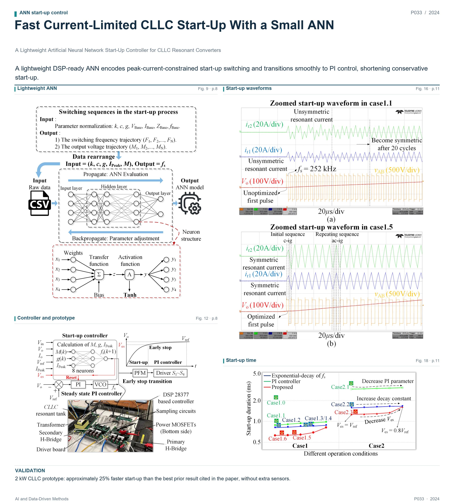

## Abstract

The start-up of CLLC resonant converters presents challenges such as high inrush current and voltage surges. Conventional approaches often resort to conservative control parameters, which, albeit effective in mitigating resonant current during start-up, invariably extend the start-up duration. Addressing these challenges, this study investigates the optimal start-up sequence, aiming for operation within a customized peak resonant current range. A specialized, lightweight artificial neural network designed for digital signal processors is introduced as the start-up controller. This start-up controller is seamlessly integrated with the conventional proportional-integral controllers, thereby ensuring a seamless transition from start-up to steady-state operation. The effectiveness of the proposed methodology is corroborated through experiments on a 2-kW CLLC prototype, which showcases the elimination of inrush current and approximately 25% enhancement in start-up speed over the best outcomes of existing methods, all achieved without the need for additional sensors or reliance on trial-and-error adjustments.

<figure id="research-figure" class="publication-figure">
  
</figure>
