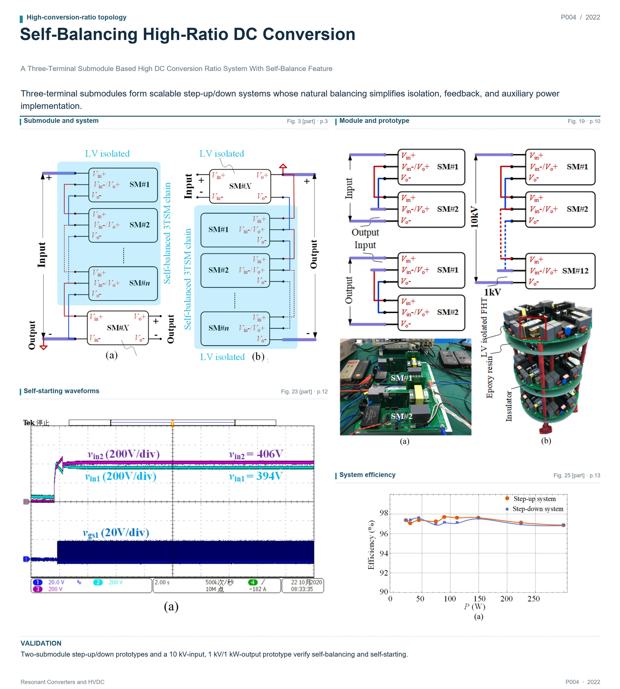

## Abstract

The input series output parallel (ISOP) and input parallel output series (IPOS) systems have been extensively researched and applied in academia and industry due to the high dc conversion ratio. Practically, the ISOP and IPOS systems faced challenges, such as relatively immature high-voltage (HV) isolated high-frequency transformer (HFT), high reliability on HV isolated control system, difficulties in the auxiliary power supply (APS), start-up process, and bypass circuit/strategy. To overcome the above-mentioned challenges without adding complexities, this article proposes the three-terminal submodule (3TSM) as the fundamental SM for high dc conversion ratio step-up/step-down applications. Thanks to the 3TSM, the system is with self-balance feature, HV isolated HFTs are unnecessary, the control system is simplified (no matter in open or closed loop). Besides, commercial APSs can be adopted directly to the SM input capacitors without the unstable “runaway” phenomenon. A bypass circuit is also proposed to retain the power of APS when the SM is bypassed. A 2SM step-down and step-up prototype, together with a subsequent 10-kV input 1 kV/1 kW output converter is built to validate the effectiveness and practical feasibility of the proposed system.

<figure id="research-figure" class="publication-figure">
  
</figure>
