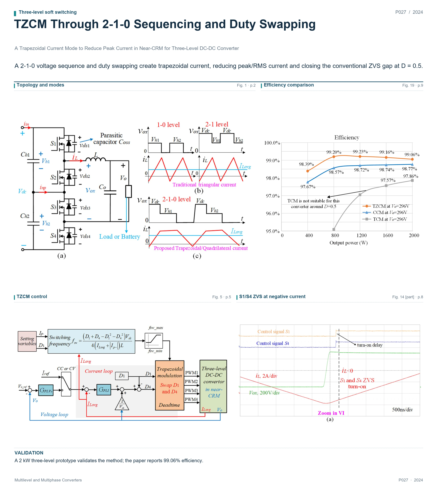

## Abstract

Triangular current mode (TCM) and near-critical conduction mode (near-CRM) are popularly used in dc–dc converters to achieve zero-voltage switching (ZVS). However, they encounter a huge peak current problem, more than twice the average current. To solve this problem, this article proposes a novel trapezoidal current mode (TZCM) for three-level dc–dc converters, aiming to reduce the inductor peak current and realize ZVS simultaneously. A trapezoidal modulation with 2-1-0 level sequences and duty cycle swapping is developed to generate the trapezoidal inductor current. To take advantage of the TZCM, a variable switching frequency control is proposed to realize ZVS for all switches in the full operating range. Compared with TCM, the proposed TZCM and its modulation not only reduce the conduction and turn-off losses of the power switches by lowering the peak and rms currents but also realize ZVS at D = 0.5, where ZVS cannot be realized in the traditional modulation because the inductor current ripple is equal to zero. The proposed TZCM and variable switching frequency control are validated using a 2-kW prototype with 99.06% efficiency.

<figure id="research-figure" class="publication-figure">
  
</figure>
