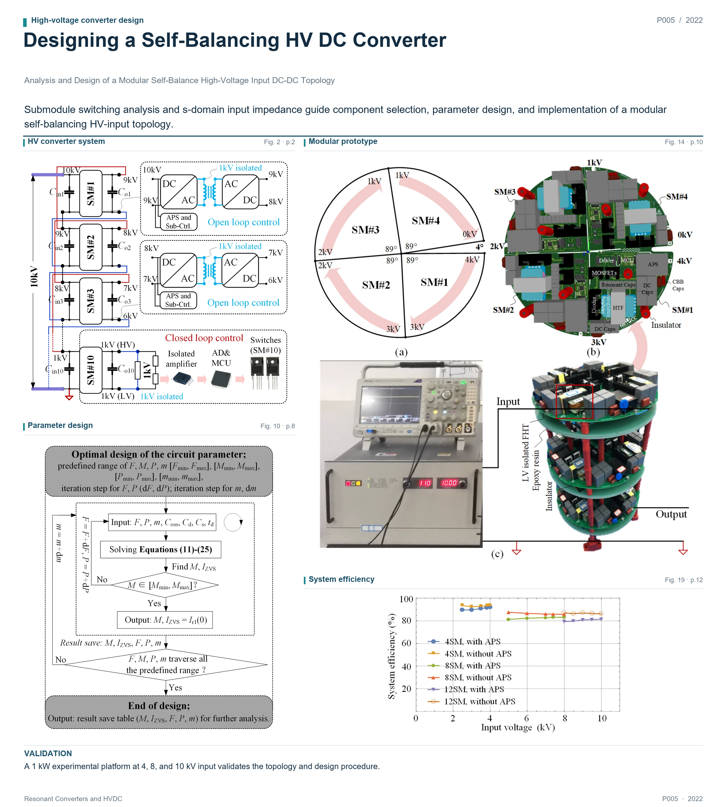

## Abstract

In high-voltage (HV) input to low-voltage (LV) output dc/dc conversion applications, the input series output parallel (ISOP) structure is widely used and studied. Practically, the ISOP system encounters the below challenges: 1) HV isolated components, such as the HV isolated and HV input extra auxiliary power supply (APS) and the HV isolated high-frequency transformers (HFTs); 2) the submodule (SM) input voltage-sharing (IVS) control must be applied as long as the system is running, and it requires the control system to be highly reliable; and 3) scarcity of simple and high-efficient startup process with commercial APSs. To overcome the above challenges and simplify the control system, this article gave analysis and design of a modular self-balance HV input dc/dc topology without HV isolated components. A detailed time-domain SM design method, as well as the s -domain SM input impedance analysis of the proposed topology, is proposed. Finally, a 4-/8-/10-kV/1-kW laboratory prototype is built to validate the effectiveness and practical feasibility of the proposed topology.

<figure id="research-figure" class="publication-figure">
  
</figure>
