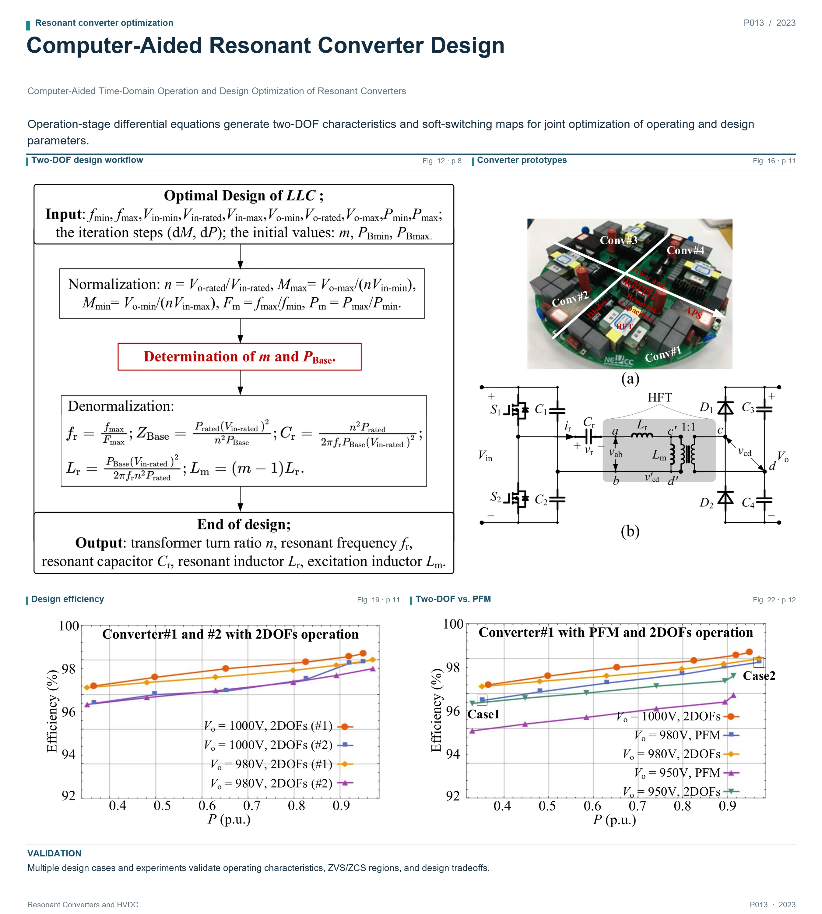

## Abstract

This article presents a method for computer-aided operation and design optimization of resonant converters using time-domain analysis. Resonant converters can operate in different operation stage trajectories (OSTs) with the change of two degrees of freedom (2DOFs), namely, switching frequency fs and duty ratio d . This article calculates and analyzes the operation characteristics, zero-voltage switching-ON (ZVS-ON) region, and zero-current switching-OFF (ZCS-OFF) region when the 2DOFs vary by solving the OST differential equation sets. Based on this analysis, an algorithm is proposed to find the operation and design optimizations of a specific resonant converter while considering 2DOFs by traversing all possible control coordinates. This article provides several case studies to demonstrate the design tradeoffs in different scenarios, which are verified through experimental verifications.

<figure id="research-figure" class="publication-figure">
  
</figure>
