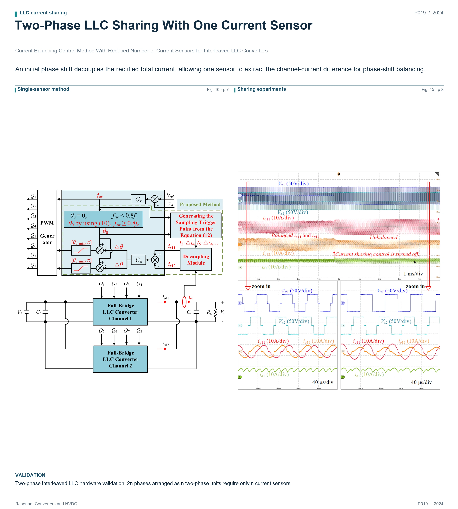

## Abstract

The multiphase interleaved LLC converter has gained significant popularity in high-power isolation applications. However, due to parameter tolerances, it requires multiple current sensors to balance the currents in parallel channels, thereby increasing sensor cost and hardware complexity. In this article, a current balancing method with reduced number of current sensors for an interleaved LLC converter is proposed to achieve cost-effective current balancing. By introducing an initial phase shift angle into the traditional variable frequency phase shift control, the total rectifier output current of the interleaved LLC converter can be decoupled into two individual currents in all operating modes. The difference between the two individual currents is used to generate phase shift angle compensation signals and then to implement the current balancing in parallel channels. As only one low ripple total current needs to be measured for two-phase interleaved LLC converters, this method effectively reduces the number of current sensors and mitigates their performance requirements. Experimental validation of the proposed current balancing method is conducted on a two-phase interleaved LLC converter.

<figure id="research-figure" class="publication-figure">
  
</figure>
