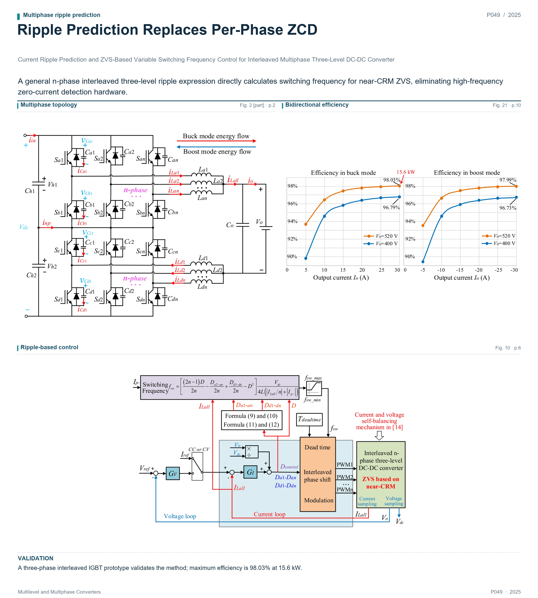

## Abstract

For high-power applications, the interleaved three-level dc–dc converter is a preferred topology to meet high voltage and high current demands. However, due to the coupling effect of multiple switches, the inductor current is not a standard triangular waveform, complicating analysis and control in near-critical conduction mode (near-CRM). This article proposes an inductor current ripple prediction method and establishes a unified current ripple expression for an interleaved n-phase three-level dc–dc converter. The unified expression for predicting current ripple is applicable to any multiphase, eliminating the traditional cumbersome solution using segmented duty cycles and case-by-case analysis for each interleaved phase number. Based on the current ripple prediction, a variable switching frequency control method is proposed that does not require additional high-frequency sensors or auxiliary circuits, enabling zero-voltage switching (ZVS) in near-CRM. The required switching frequency is calculated within a digital controller based on current ripple prediction instead of current zero-crossing detection. The proposed current ripple prediction and ZVS-based variable switching frequency control are validated in an IGBT-based 15.6-kW three-phase interleaved three-level dc–dc converter, achieving maximum efficiency of 98.03%.

<figure id="research-figure" class="publication-figure">
  
</figure>
