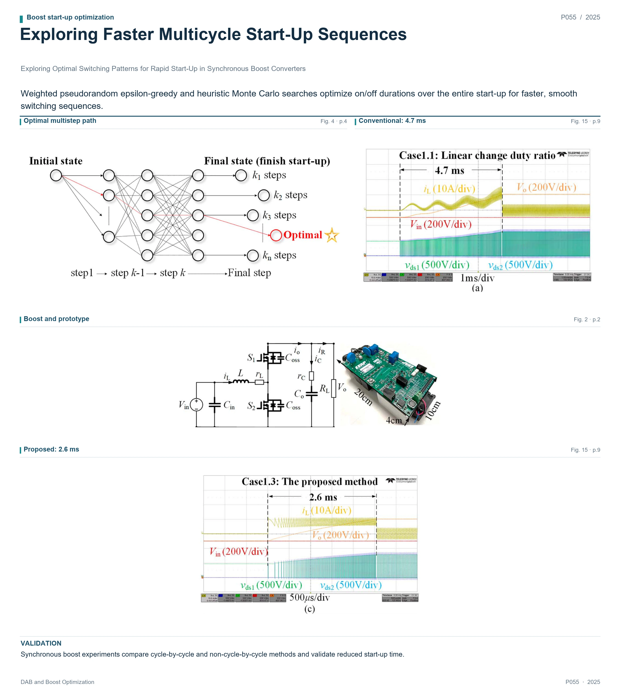

## Abstract

Achieving a smooth, efficient, and swift start-up in synchronous boost converters is essential for reducing component stress and power losses, minimizing inrush currents, and preventing damage to power conversion systems. Traditional methods fail to optimize start-up switching patterns on a cycle-by-cycle basis, leading to suboptimal inductor current control and prolonged start-up times. Optimizing switching patterns during start-up is a nondeterministic polynomial-time complete (NP-complete) challenge due to its complexity. To address this, we implement an ϵ-greedy algorithm with weighted pseudorandom decision-making for turn-on and turn-off durations, followed by heuristic Monte Carlo (MC) simulation using a “beat the top” approach to identify the fastest start-up process. Empirical testing on a synchronous boost converter confirms that our method achieves a smoother and faster start-up compared to conventional cycle-by-cycle and non-cycle-by-cycle start-up techniques.

<figure id="research-figure" class="publication-figure">
  
</figure>
