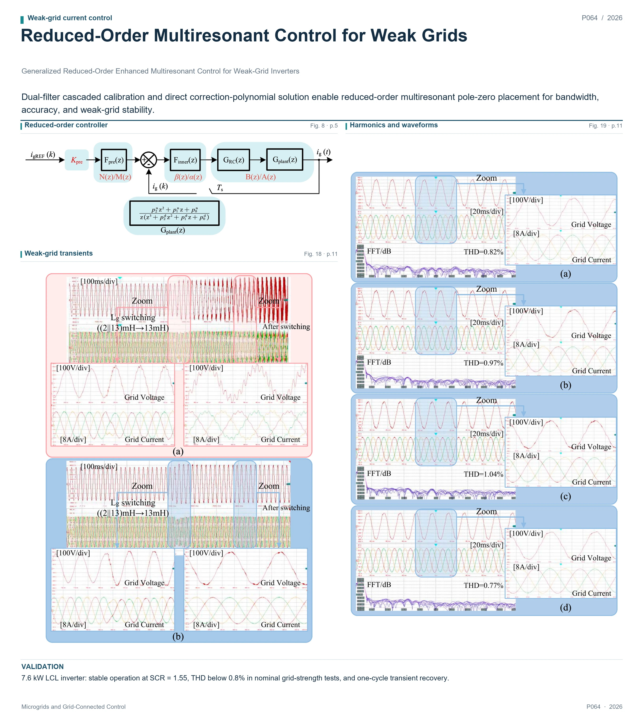

## Abstract

Weak-grid conditions arising from the increasing penetration of inverter-based resources degrade the stability margins and current-regulation performance of grid-connected inverters (GCIs) using conventional resonant controllers. To overcome these limitations, this article proposes a generalized reduced-order enhanced multiresonant controller (GREMRC) that combines a dual-filter cascaded calibration structure with a direct solution method for correction polynomials, enabling flexible closed-loop pole-zero placement with low computational effort. A systematic pole-zero placement strategy is developed to maximize bandwidth and ensure robust stability across varying grid strengths. The approach extends naturally to multiple resonant modes and diverse filter topologies. Experiments on a 7.6 kW inductor–capacitor–inductor (LCL) inverter demonstrate one-cycle transient recovery, stable operation down to standard short-circuit ratio (SCR) = 1.55, and total harmonic distortion (THD) less than 0.8% under all nominal grid-strength tests, confirming significant performance improvements over conventional resonant control.

<figure id="research-figure" class="publication-figure">
  
</figure>
