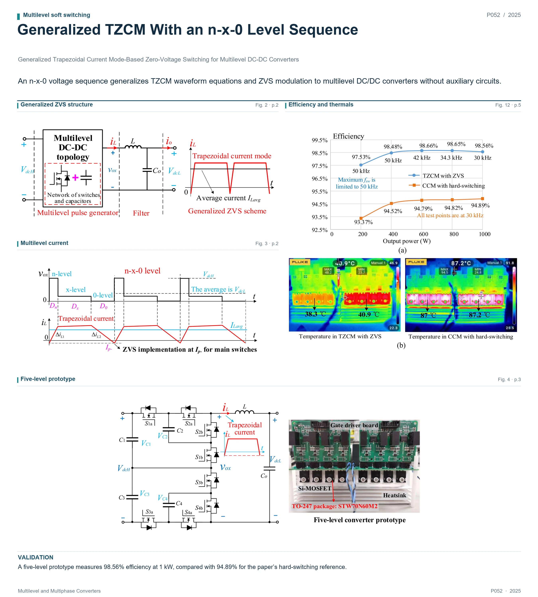

## Abstract

Achieving zero-voltage switching (ZVS) in multilevel dc–dc converters is challenging, especially without relying on triangular current mode (TCM). However, TCM becomes ineffective in operating zones with near-zero inductor current ripples and suffers from high peak current. To address these issues, this article presents an innovative generalized method inspired by the trapezoidal current mode (TZCM) of three-level converters to achieve ZVS in any multilevel dc–dc converter. A generalized TZCM modulation using an n-x-0 voltage-level sequence is proposed, while the system of equations governing the trapezoidal current waveform is derived. A five-level dc–dc converter is used as an example to illustrate the trapezoidal current modulation, ZVS process, and duty cycle alternation sequence. The proposed method enables ZVS in all multilevel topologies while reducing peak current compared to traditional TCM. Experimental results from a five-level dc–dc converter prototype validate the effectiveness of the generalized TZCM-based ZVS method, which achieves an efficiency of 98.56% at 1 kW, significantly surpassing the 94.89% efficiency of hard-switching.

<figure id="research-figure" class="publication-figure">
  
</figure>
