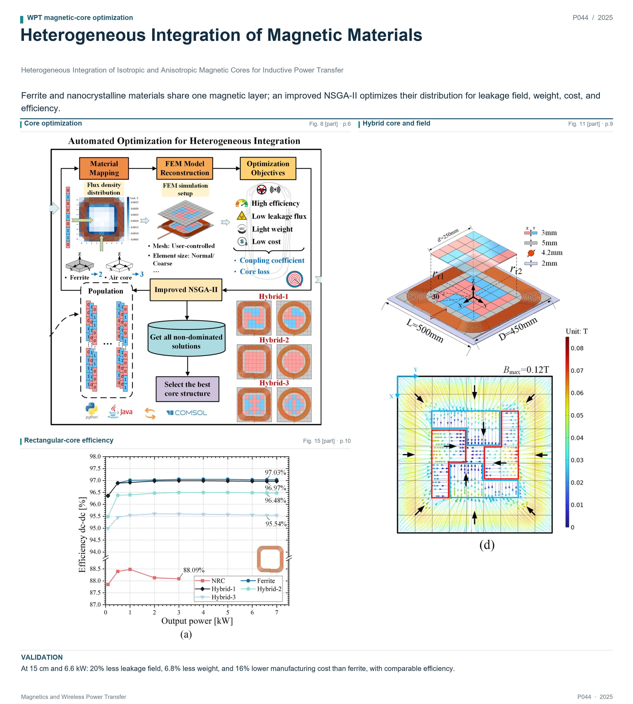

## Abstract

The bulky installation and inevitable flux leakage of magnetic couplers create significant challenges for wireless charging applications in future self-driving vehicles. Ferrite cores and nanocrystalline ribbon cores have superior characteristics in terms of low eddy current loss and high saturation flux density, respectively. This article proposes a physics-aware hybrid magnetic core design method that integrates both isotropic and anisotropic materials into a single layer of magnetic plate to fully utilize their advantages. Furthermore, the optimal distribution of hybrid magnetic cores is determined by an improved nondominated sorting genetic algorithm II, which reveals a general rule that anisotropic materials can be arranged in an interleaved pattern within regions of low magnetic field strength in unipolar coils to enhance the power density of the coupler and reduce its flux leakage. Compared to the design with pure ferrite cores, experimental results show that the proposed hybrid core design for a rectangular coil can reduce flux leakage, weight, and manufacturing cost by 20%, 6.8%, and 16%, respectively, at a transfer distance of 15 cm and a transfer power of 6.6 kW, without sacrificing transfer efficiency.

<figure id="research-figure" class="publication-figure">
  
</figure>
