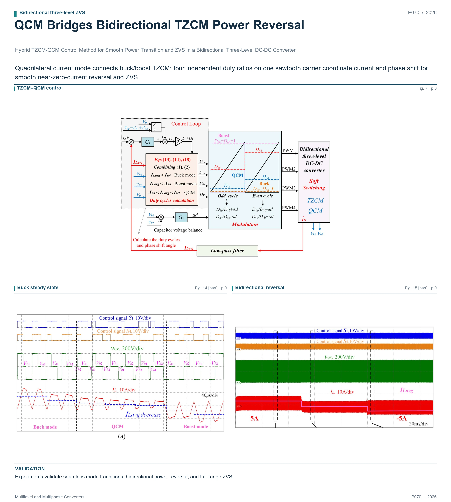

## Abstract

Bidirectional three-level DC-DC converters are widely employed in battery and supercapacitor energy storage systems owing to their low voltage stress and compact passive components. However, the inherent near-zero current transition during bidirectional power operation prevents the standalone trapezoidal current mode (TZCM) from achieving zero-voltage switching (ZVS) in the converter. To address this issue, this paper proposes a hybrid mode control scheme that integrates TZCM and quadrilateral current mode (QCM), enabling both smooth bidirectional power transition and full-range ZVS. A novel modulation principle is proposed, which compares four independent duty cycles against a common sawtooth carrier to facilitate operation in three distinct modes: Buck mode based on TZCM with 2-1-0 level sequence, QCM with 1-2-1-0 level sequence, and Boost mode based on TZCM with 0-1-2 level sequence. Then, by establishing the relationship between these duty cycles and the average inductor current, both the phase shift angle and average inductor current can be precisely regulated through duty cycles adjustment. Based on this concept, a hybrid mode control scheme is developed, ensuring seamless bidirectional power transfer and full-range ZVS soft switching. The effectiveness of the proposed control method is validated by an experimental prototype.

<figure id="research-figure" class="publication-figure">
  
</figure>
