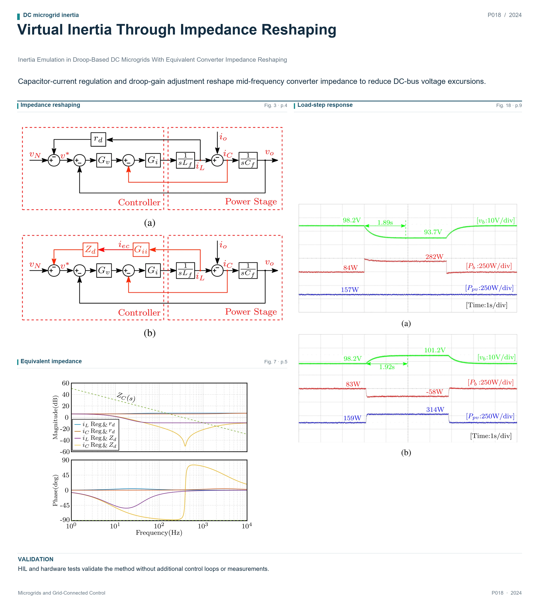

## Abstract

This article presents a swift and seamless start-up method for dual active bridge (DAB) converters, adhering to a predefined current limit. It explores all operation stage trajectories to identify the optimal switching sequence in both constant frequency (CF) and variable frequency (VF) modes. The method seamlessly integrates sophisticated modulation schemes, avoiding dc bias during start-up and transition phases, and achieves zero voltage switching (ZVS) across all power switches. The effectiveness of the proposed CF and VF modes have been validated through experiments on a 1.2-kW DAB prototype. Compared with conventional methods, this approach accelerates start-up speed by 60% to 80%, significantly enhancing performance.

<figure id="research-figure" class="publication-figure">
  
</figure>
