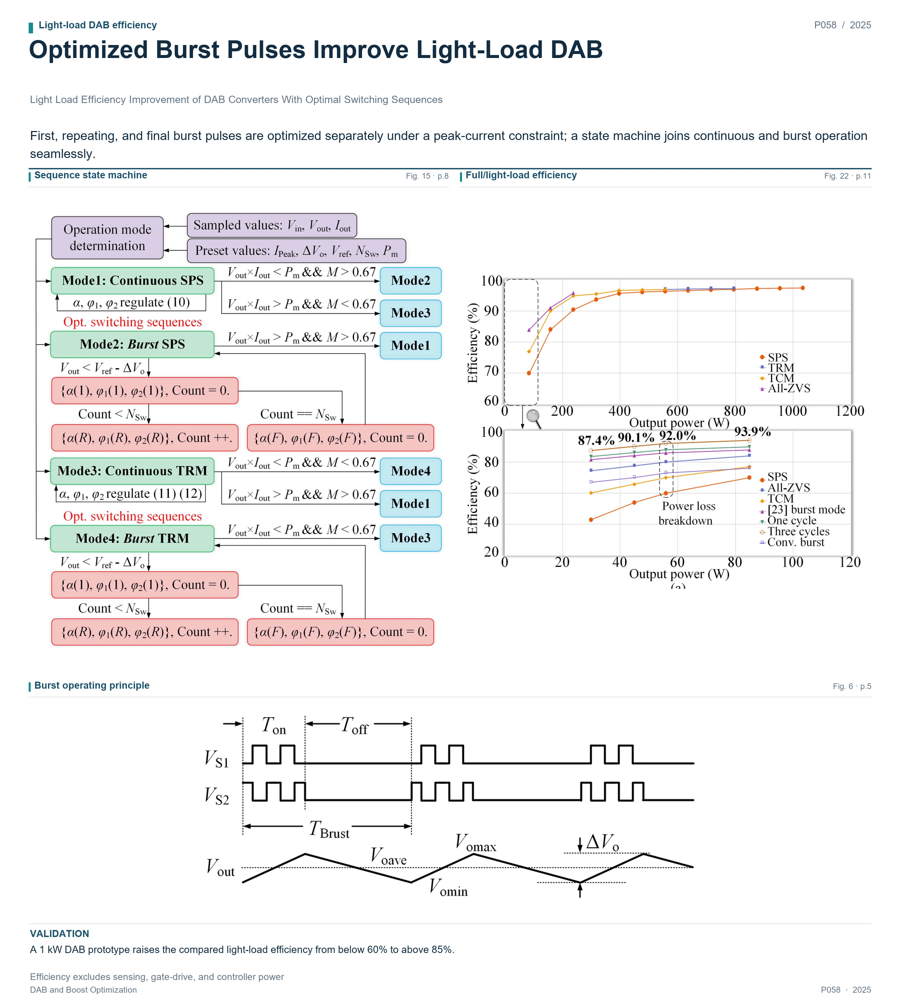

## Abstract

This article introduces a method to enhance the light load efficiency of dual active bridge converters through power loss minimization via optimal switching sequences. Peak efficiency points for various operational conditions are identified using a comprehensive power loss calculation approach. Single phase shift modulation and trapezoidal current modulation modes are utilized, and an iterative algorithm determines the optimal switching sequence for the first, repeating, and final switching pulses under a given peak inductor current in various operating condition. The comprehensive state machine diagram of the proposed control method demonstrates seamless integration of both continuous and burst modes for efficiency improvement. Experimental waveforms, efficiency curves, and power loss breakdown diagrams from a 1 kW prototype demonstrate that the proposed method significantly outperforms continuous operation mode, as well as conventional and advanced burst modes, increasing light load efficiency from below 60% to above 85%.

<figure id="research-figure" class="publication-figure">
  
</figure>
