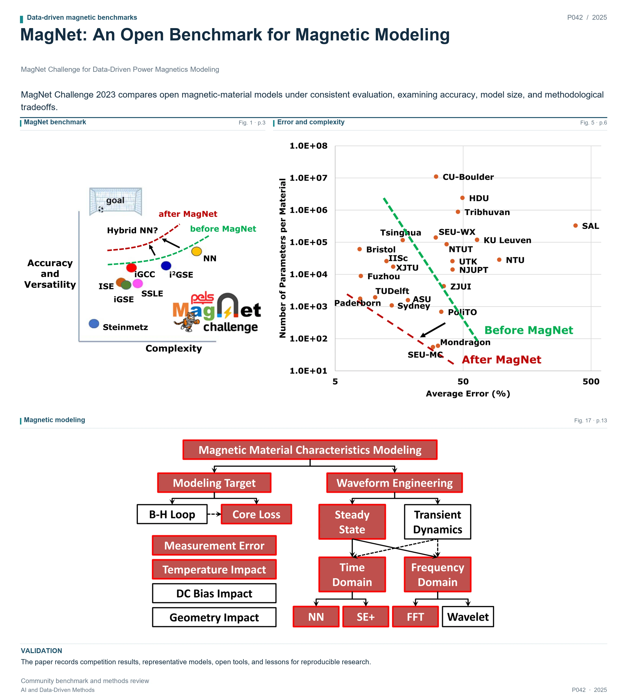

## Abstract

This article summarizes the main results and contributions of the MagNet Challenge 2023, an open-source research initiative for data-driven modeling of power magnetic materials. The MagNet Challenge has (1) advanced the state-of-the-art in power magnetics modeling; (2) set up examples for fostering an open-source and transparent research community; (3) developed useful guidelines and practical rules for conducting data-driven research in power electronics; and (4) provided a fair performance benchmark leading to insights on the most promising future research directions. The competition yielded a collection of publicly disclosed software algorithms and tools designed to capture the distinct loss characteristics of power magnetic materials, which are mostly open-sourced. We have attempted to bridge power electronics domain knowledge with state-of-the-art advancements in artificial intelligence, machine learning, pattern recognition, and signal processing. The MagNet Challenge has greatly improved the accuracy and reduced the size of data-driven power magnetic material models. The models and tools created for various materials were meticulously documented and shared within the broader power electronics community.

<figure id="research-figure" class="publication-figure">
  
</figure>
