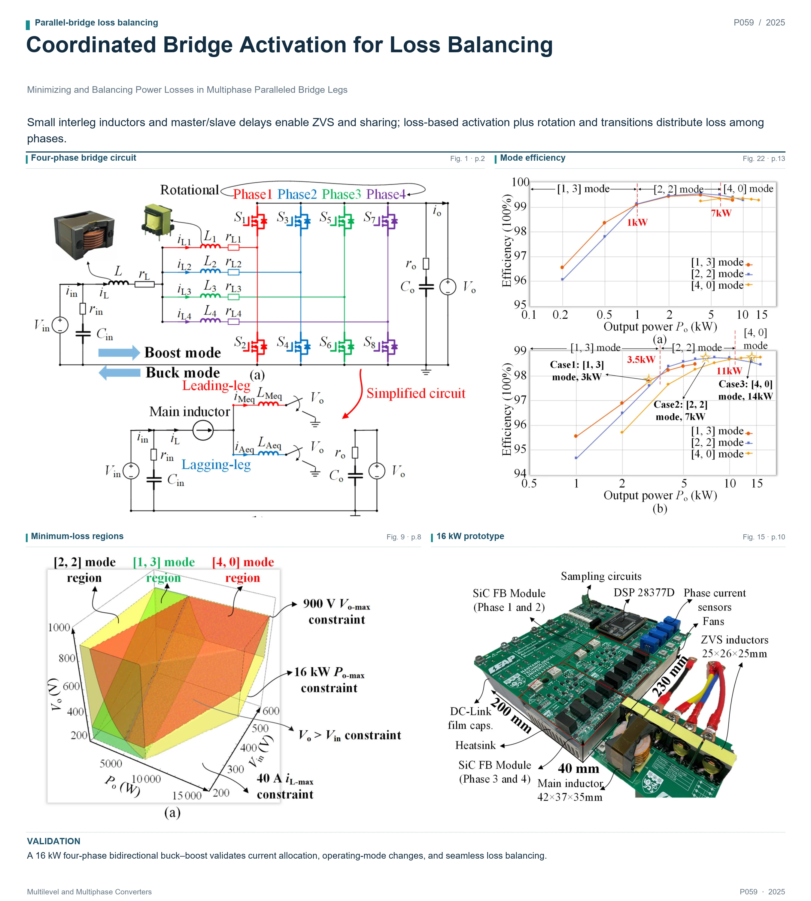

## Abstract

Multiple silicon carbide power mosfets are often paralleled for high current capability but can suffer from imbalanced switching currents and high switching losses, particularly in partial load scenarios. This article explores power loss minimization and balancing methods for N-phase paralleled bridge legs with small inductors at the switching nodes, using a 16-kW four-phase bidirectional buck–boost converter as a case study. By controlling the number of bridge legs and the delays between leading and lagging phases, total power losses are minimized through a detailed power loss calculation method. Steady-state rotational and dynamic balancing techniques are proposed to ensure balanced power losses and thermal stresses among phases. Experimental results demonstrate effective phase current sharing via zero-voltage switching inductors, with seamless and rapid power loss balancing. Different operation modes automatically adjust for minimal power loss, and measured losses align well with theoretical calculations, validating the proposed methods.

<figure id="research-figure" class="publication-figure">
  
</figure>
