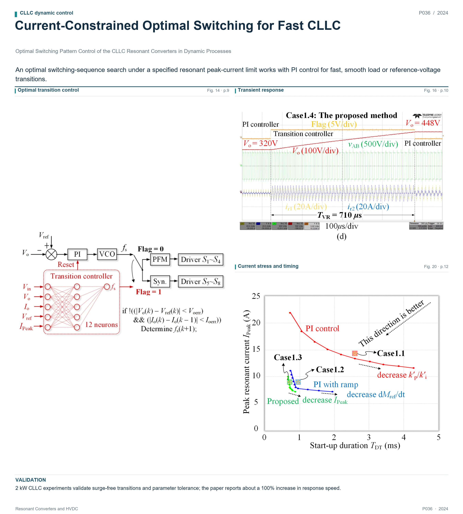

## Abstract

The CLLC resonant converters are preferred for their high-power density and high efficiency. Nevertheless, their dynamic performance deteriorates due to the low impedance characteristic of the resonant tank near resonant frequency. This study proposes optimal switching patterns under specified peak resonant current conditions to enable rapid and smooth dynamic transitions. Building on this, a seamless, synergetic control strategy is developed for integration with the widely used proportional-integral controllers. The efficacy of this methodology is validated on a 2-kW CLLC resonant converter prototype, demonstrating zero inrush current and approximately ∼100% increase in the speed of dynamic response compared to existing techniques, across both step load changes and output voltage reference changes. Remarkably, the proposed methodology maintains high performance despite significant electrical component parameter variances, obviating the necessity for supplementary sensors.

<figure id="research-figure" class="publication-figure">
  
</figure>
