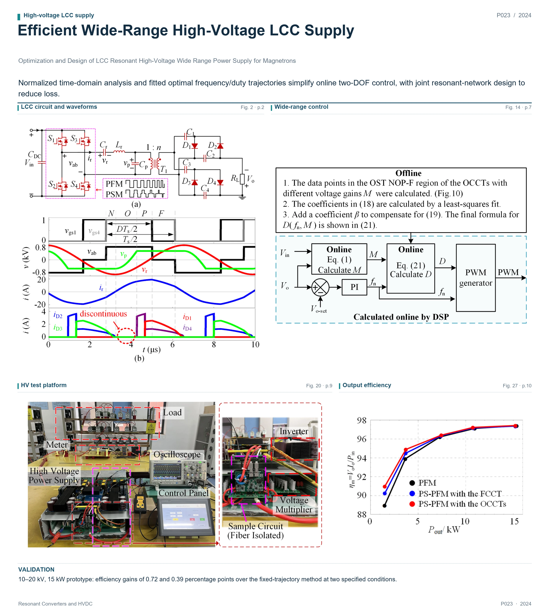

## Abstract

Due to the integration and utilization of the parasitic capacitance of the transformer, the LCC resonant converters with a capacitive output filter are widely used in high-voltage power supplies for microwave generation, X-ray, ion implantation, and other fields. However, it is challenging for the LCC to maintain high efficiency in a wide output voltage range. In this article, an optimal control coordinate trajectories (OCCTs)-based phase-shift pulse-frequency modulation (PS-PFM) control method is proposed to achieve high efficiency by reducing the switching frequency range and the turn-off current. With the normalized time-domain analysis, the operation stage trajectories of LCC and their boundary conditions under the PS-PFM control are derived. Based on this, the OCCTs of the switching frequency and the duty cycle at different voltage gains are precisely calculated. By associating the duty cycle with the switching frequency and the output voltage gain through a fit equation based on the OCCTs data, the proposed PS-PFM control strategy can adaptively adjust the optimal duty cycle, simplifying one of the control freedom degrees. Then, an optimization design algorithm for the resonant network parameter is proposed to reduce the conduction loss of LCC. Finally, a 10–20-kV/15-kW LCC resonant high-voltage power supply prototype is built to verify the feasibility of the proposed control strategy.

<figure id="research-figure" class="publication-figure">
  
</figure>
