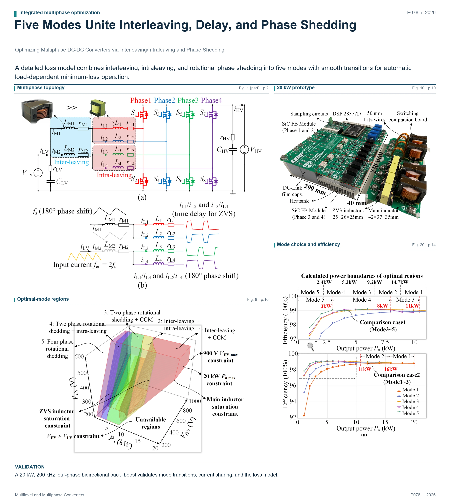

## Abstract

Minimizing and balancing power loss across the full operating range is crucial for multi-phase DC-DC converters. Techniques like inter-leaving, intra-leaving, and phase shedding are widely used for this purpose. Inter-leaving balances power loss and reduces current ripple, making it suitable for high-power applications. Intra-leaving adjusts time delays between bridge legs to enable zero-voltage switching (ZVS), optimizing efficiency under partial loads where switching loss is dominant. Phase shedding deactivates phases under light loads to reduce switching losses. This paper investigates power loss minimization in a four-phase bidirectional buck-boost converter, utilizing an optimal combination of these techniques based on precise power loss calculations. The converter operates in five modes: (1) inter-leaving + continuous conduction mode (CCM), (2) inter-leaving + intra-leaving, (3) two-phase rotational shedding + CCM, (4) two-phase rotational shedding + intra-leaving, and (5) four-phase rotational shedding. Smooth transitions within and between these modes are achieved. Experimental results confirm that the converter automatically adjusts modes to optimize performance, with measured losses aligning closely with theoretical predictions.

<figure id="research-figure" class="publication-figure">
  
</figure>
