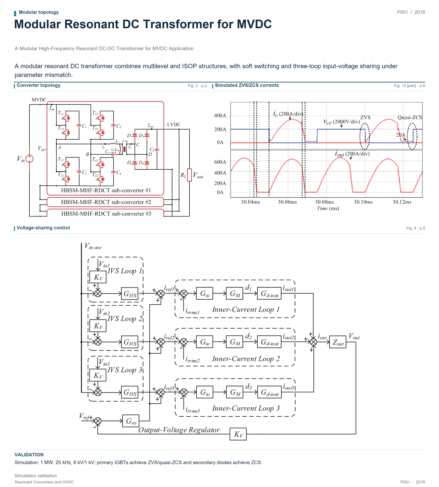

## Abstract

This paper proposes a modular high frequency resonant DC-DC transformer (MHF-RDCT) in medium- voltage DC (MVDC) to low-voltage DC (LVDC) application. The proposed MHF-RDCT is a reconfiguration of modular multilevel DC-DC converter (MMDC) and input series output parallel (ISOP) structure. The proposed MHF-RDCT has features of high power, galvanic isolation, high power density and high efficiency. Phase shift modulation (PSM) is adopted and thanks to the resonant tank, zero voltage switching (ZVS) and Quasi zero current switching (Quasi-ZCS) for primary IGBTs and ZCS for secondary diodes can be implemented easily. The operation principle is described and the control system is developed to implement power transmission. Due to three loop control strategy, input voltage sharing can be achieved under parameter mismatch conditions. A case of 1MW 20kHz 6kV-lkV MHF-RDCT is simulated for validation of the proposed MHF-RDCT.

<figure id="research-figure" class="publication-figure">
  
</figure>
