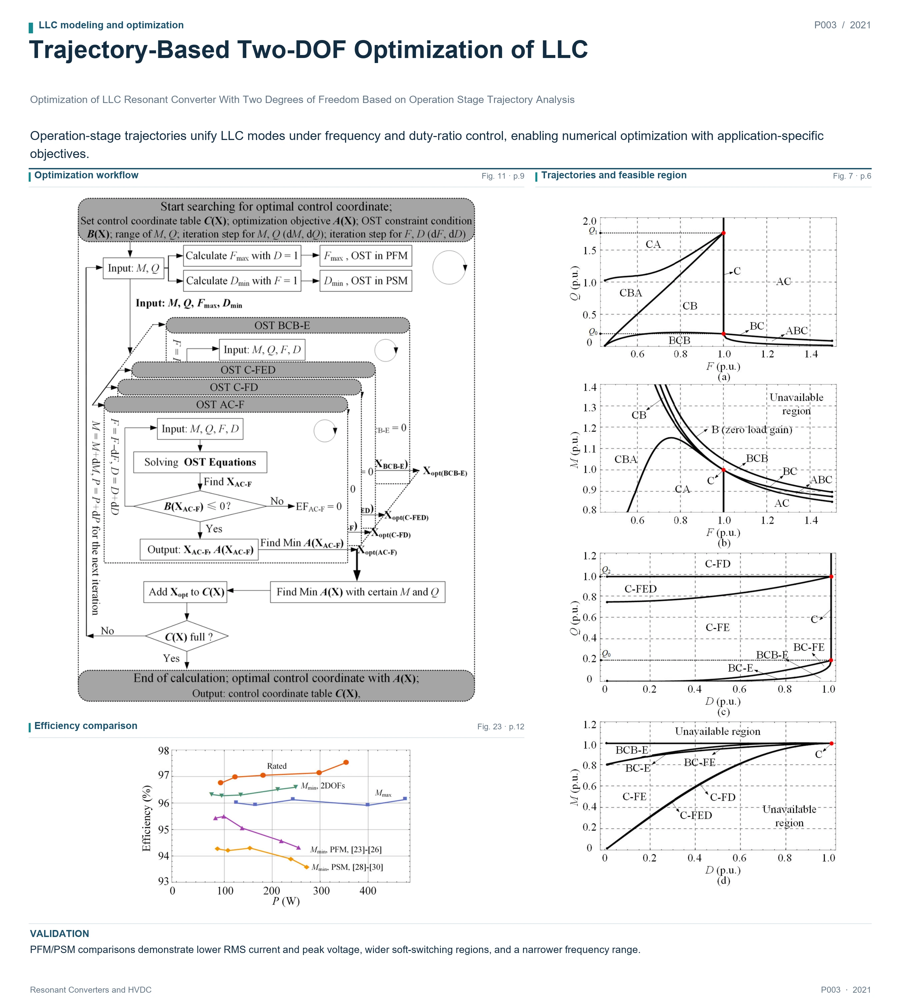

## Abstract

LLC resonant DC-DC converter has been widely used in high power density and high efficiency applications. Pulse frequency modulation (PFM) is commonly applied due to its wide soft-switching range. In some special cases, phase shift modulation (PSM) is applied to widen voltage regulation range, improve light-load efficiency, or implement a soft start-up process. Because LLC is with 2 control degrees of freedom (2DOFs), switching frequency and duty ratio, a unified analysis and optimization for LLC with 2DOFs is desired. This paper makes an effort to present a unified time domain operation stage trajectories (OSTs) analysis of LLC. On this basis, a unified numerical optimization method is proposed with arbitrarily designed optimization objectives. With the proposed optimization method, the optimized LLC with 2DOFs is with better performance compared to conventional PFM and PSM, which is verified by the experimental results.

<figure id="research-figure" class="publication-figure">
  
</figure>
