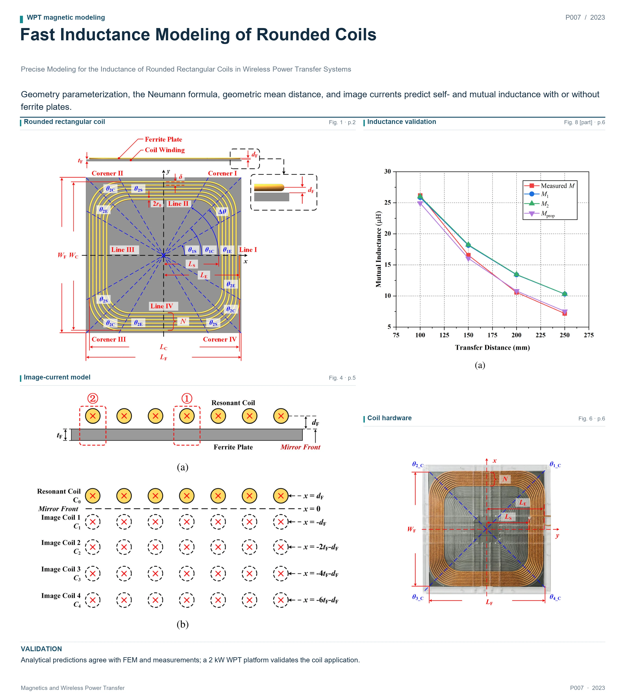

## Abstract

This paper introduces a novel analytical model for the accurate inductance calculation of rounded rectangular coils in wireless power transfer systems (WPTSs). Comprehensive analysis is conducted for the rounded rectangular coil and a new parametric model is proposed to precisely define its structure. A new inductance calculation model is proposed for the rounded rectangular coils based on Neumann's formula and the obtained parametric structure model. The Geometric Mean Distance method is introduced to reduce the complexity and difficulty of self-inductance modeling. The image current method is adopted to achieve accurate inductance modeling for rounded rectangular coils with ferrite plates. Finally, the accuracy of the proposed analytical model is validated and compared with two other traditional methods. It turns out that the proposed models can achieve high calculation accuracy in self-inductance and mutual inductance calculation. The proposed model exhibits the merits of high accuracy and fast calculation speed which makes it promising for future coil designing and optimization.

<figure id="research-figure" class="publication-figure">
  
</figure>
