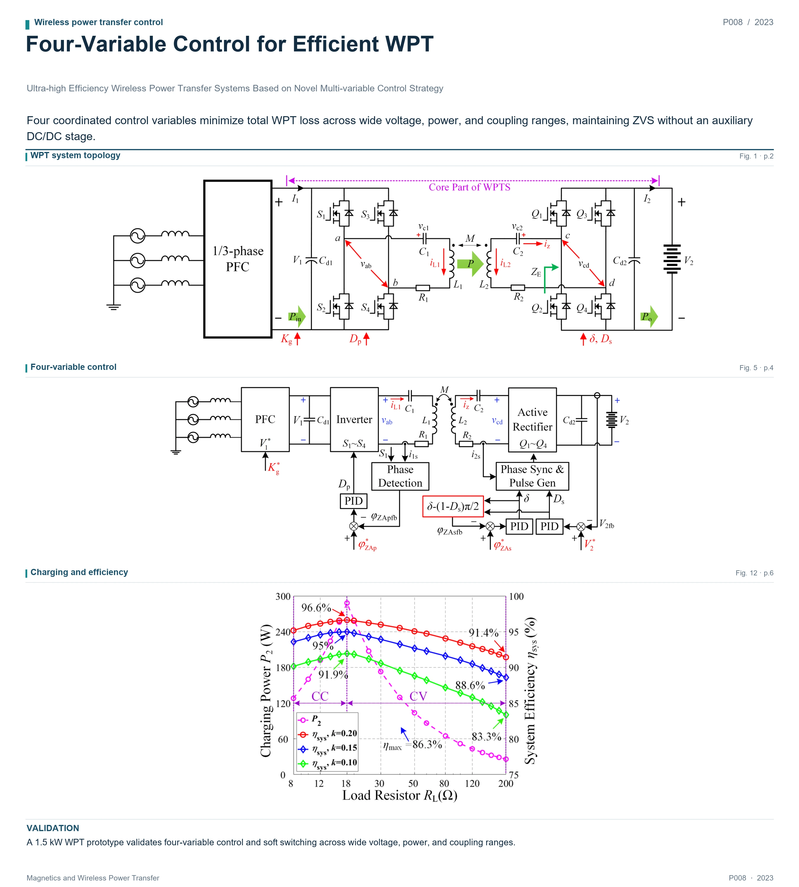

## Abstract

In this paper, an ultra-high efficiency wireless power transfer system (WPTS) with wide ranges of charging voltage, power and coupling coefficient of resonant coils is proposed. First, the mathematical model of the system transfer efficiency based on the novel multi-variable control strategy is derived to precisely analyze power losses of the WPTS. Second, a novel coordinated control strategy with four control variables is proposed to achieve ultra-high efficiency wireless energy transfer with wide voltage and power ranges without any auxiliary dc-dc converters. Third, the minimum power loss model of the WPTS is analyzed and built. Meanwhile, the minimum power loss points and their operating conditions are derived and summarized. Finally, compared with the traditional control method in the same cases, the WPTS with the proposed coordinated control strategy not only can achieve ZVS operation of all switches, but also can further improve the overall system transfer efficiency and extend the operating ranges of the output voltage and power. Finally, a 1.5-kW experimental prototype is built to verify the effectiveness of the proposed coordinated control strategy. The experimental results show that the transfer efficiency of the designed WPTS can achieve 96.6% with the coupling coefficient k = 0.2.

<figure id="research-figure" class="publication-figure">
  
</figure>
