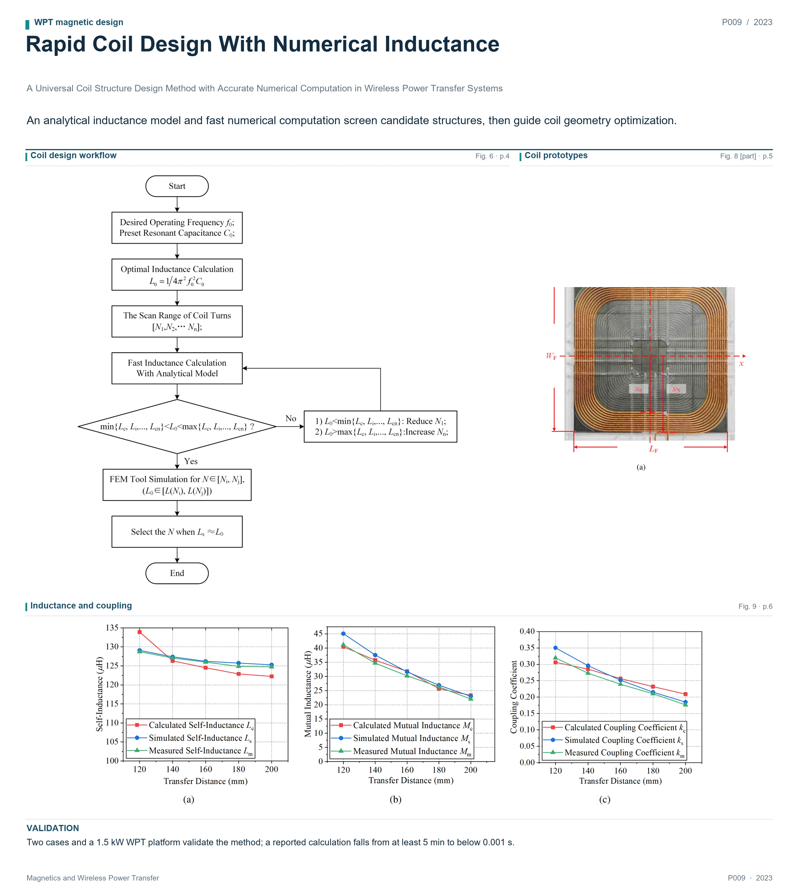

## Abstract

Conventional design and optimization methods for resonant coils in wireless power transfer systems (WPTSs) heavily rely on finite element simulations, which are very time-consuming and complex. In this paper, a novel Universal Coil Structure Design (UCSD) method is proposed to accelerate and optimize the design process of rounded rectangular coils in WPTSs. First, the analytical model of the resonant coil’s self-inductance is derived when no ferrite plate is added. Second, the image current method is adopted to calculate coil’s self-inductance when ferrite plates are added. Accurate numerical calculation methods are used for the derived analytical model to calculate the coil’s self-inductance quickly and precisely. Next, the working principle of the UCSD method is presented. The UCSD method can calculate the self-inductances of rectangular coils with the proposed analytical model and pinpoint the most possible range of optimal coil structure according to the given requirements from different WPTSs. Subsequently, the proposed UCSD method is applied to determine the optimal coil structures for two case studies with much less time consumption. Finally, a 1.5-kW WPT system prototype is built to verify the effectiveness of the proposed UCSD method. With the coupling coefficient k = 0.2, the maximum transfer efficiency reaches 95.57% and 94.91% for Case I and Case II while k = 0.15, the maximum transfer efficiency reaches 96.07% and 95.37% for Case I and Case II.

<figure id="research-figure" class="publication-figure">
  
</figure>
