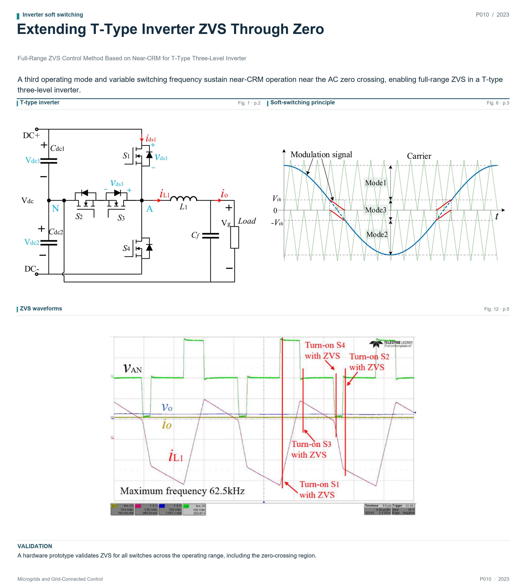

## Abstract

T-type inverter is attractive due to low conduction losses and low switching voltage, and small size of passive component. Usually, zero-voltage switching (ZVS) without auxiliary circuit can be easily achieved by controlling the inverter to operate in the near critical conduction mode (near-CRM). However, with conventional modulation, T-type inverter require an extremely low switching frequency to achieve near-CRM mode when the AC voltage crosses zero, which is impractical for the digital controller. This paper proposes a new third-mode based modulation method and a variable switching frequency control method to make the T-type inverter into near-CRM. The proposed method is able to make all switches achieve ZVS soft-switching at full-range operation. The effectiveness and performance of the proposed modulation and control are validated by an experimental prototype.

<figure id="research-figure" class="publication-figure">
  
</figure>
