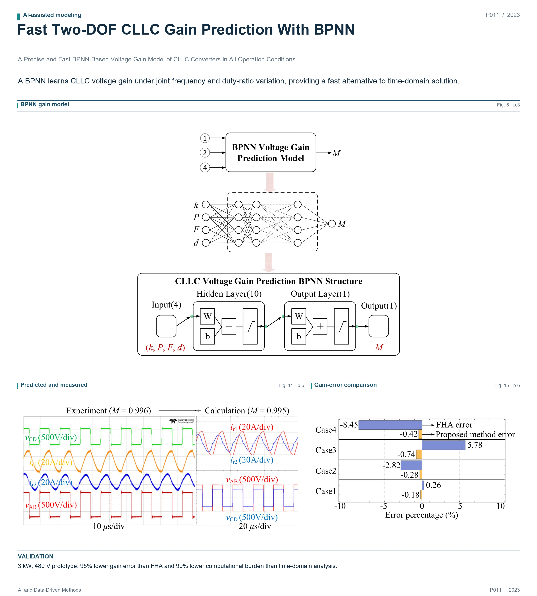

## Abstract

The CLLC resonant converters are widely used in data center, battery chargers, electrical vehicles due to its high efficiency and high power density. The voltage gain characteristic of CLLC resonant converters plays an important role in both operation analysis and design optimization. This paper presents a precise and fast backpropagation neural network (BPNN)-based voltage gain model of CLLC that considers two degrees of freedom (2DOFs), the switching frequency f_s and duty ratio d, in all operation conditions. The effectiveness of the model is verified by a 3-kW 480-V CLLC prototype. The voltage gain error is reduced by 95% compared to the conventional fundamental harmonic approximation (FHA) method, and the calculation burden is reduced by 99% compared to the time-domain method.

<figure id="research-figure" class="publication-figure">
  
</figure>
