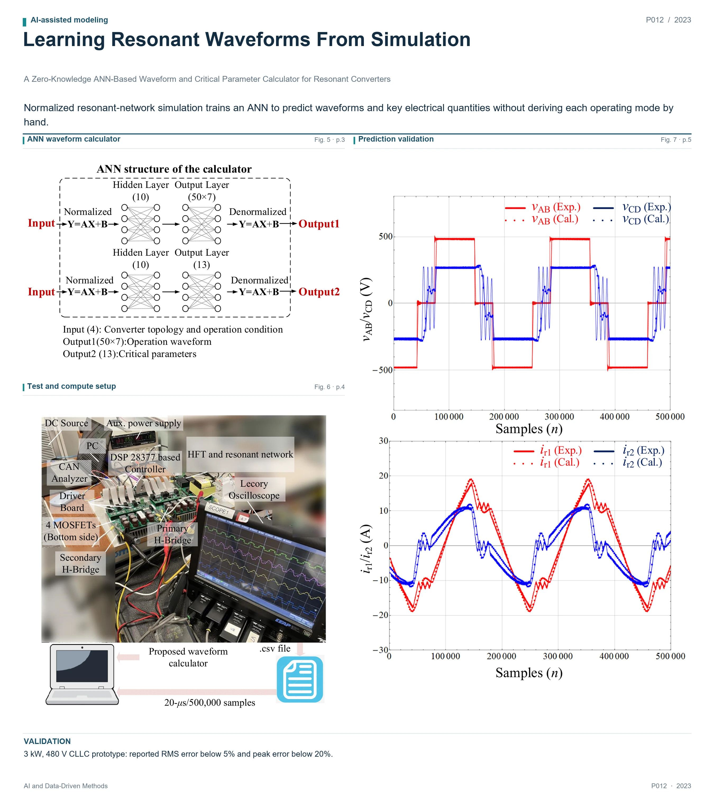

## Abstract

Despite the widespread use of resonant converters in various applications, their analysis and design still necessitate a solid comprehension of the converter's operating principle and nonlinear behavior, which can be a significant manpower burden. To alleviate this issue and free us from repetitive work, this paper proposes a zero-knowledge artificial neural network (ZANN)-based waveform and critical parameter calculator for resonant converters. A normalized resonant network is employed to generate adequate data for training the ZANN. The ZANN can identify the essential characteristics of different resonant networks based on the configuration of hyperparameters. The accuracy of the calculator is verified using a 3-kW 480-V CLLC prototype. The results show that the accuracy of the root-mean-square (RMS) values is less than 5%, while the accuracy for the peak values is less than 20%.

<figure id="research-figure" class="publication-figure">
  
</figure>
