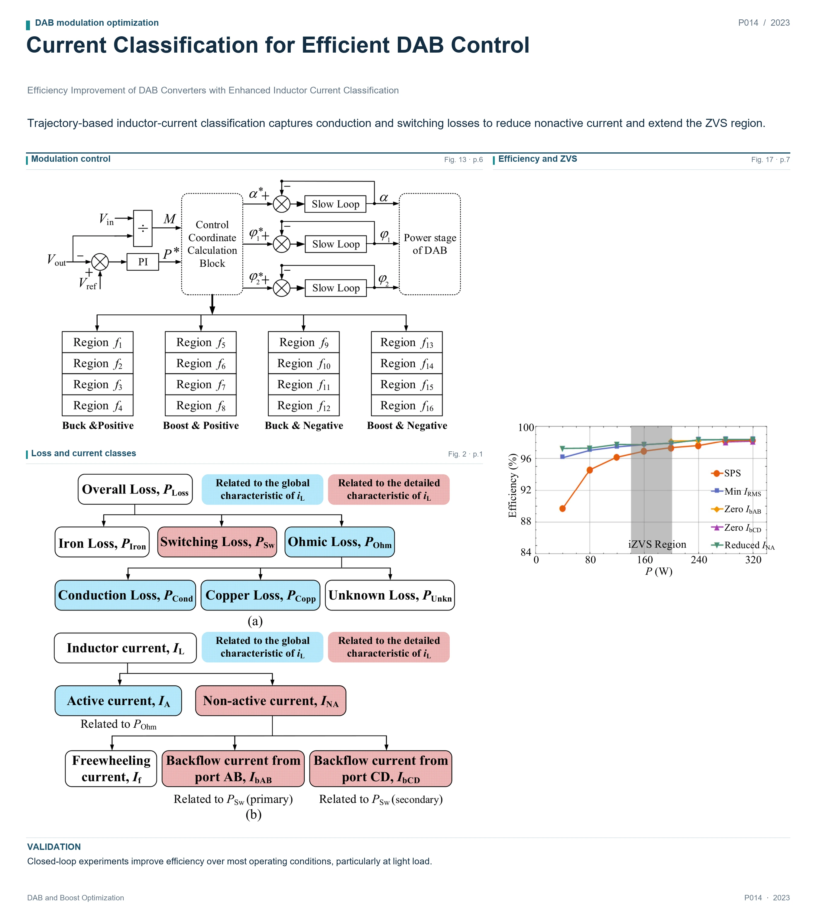

## Abstract

The inductor current plays an important role in dual active bridge converters (DAB) because the ohmic loss and the switching loss are related to the global and detailed characteristics of the inductor current. For most of the previous articles, these two characteristics are analyzed separately, and the DAB efficiency is not be considered comprehensively. This paper gives the operation stage trajectory (OST) analysis based on the intrinsic characteristic of DAB with triple-phase shift modulation scheme (TPS). A novel inductor current classification method considering both the global and detailed characteristics is proposed. On this basis, a reduced non-active current modulation scheme is proposed with a small amount of non-active current while extending the ZVS operation region. The experimental results obtained from the laboratory prototype are given to validate the practical feasibility of the proposed modulation scheme with a closed loop control diagram, and the effectiveness of the proposed inductor current classification method.

<figure id="research-figure" class="publication-figure">
  
</figure>
