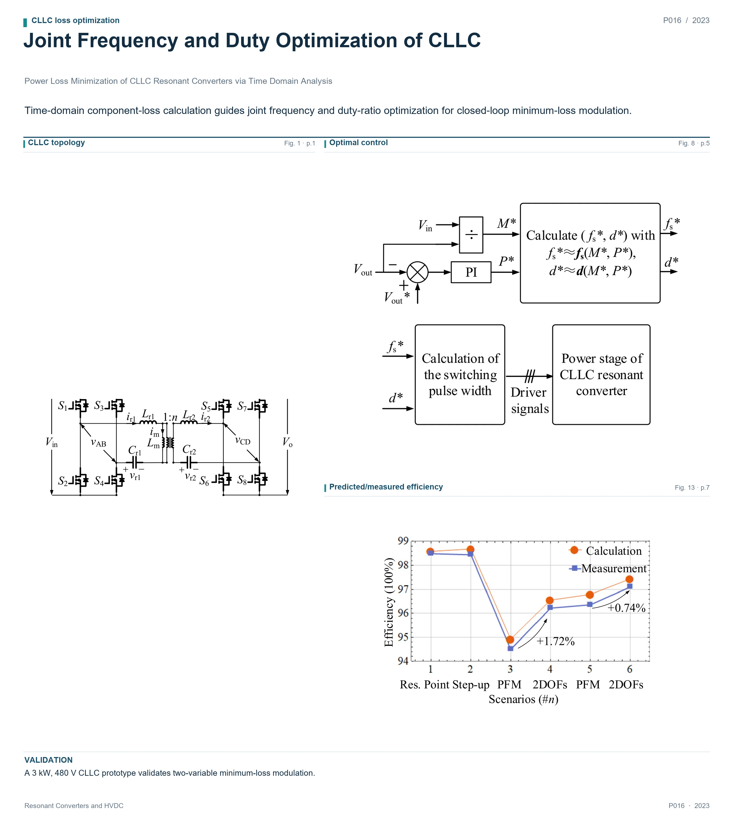

## Abstract

The symmetric CLLC resonant converter has distinguished potential in battery chargers and energy storage systems due to zero voltage switching-on (ZVS-on) and flexible control with multiple degrees of freedom. However, the widely used frequency domain analysis lacks accuracy, and most time domain analysis only considers pulse frequency modulation (PFM), which limits the efficiency of CLLC, especially in step-down and light load conditions. To fully exploit the potential of CLLC resonant converters, this paper conducts a time domain analysis to search for the two control variables: optimal switching frequency and duty ratio of CLLC, aiming to minimize power loss. Additionally, a closed-loop power loss minimization modulation is proposed based on this analysis. The effectiveness of the proposed method is verified through experimentation on a 3-kW 480-V CLLC prototype.

<figure id="research-figure" class="publication-figure">
  
</figure>
