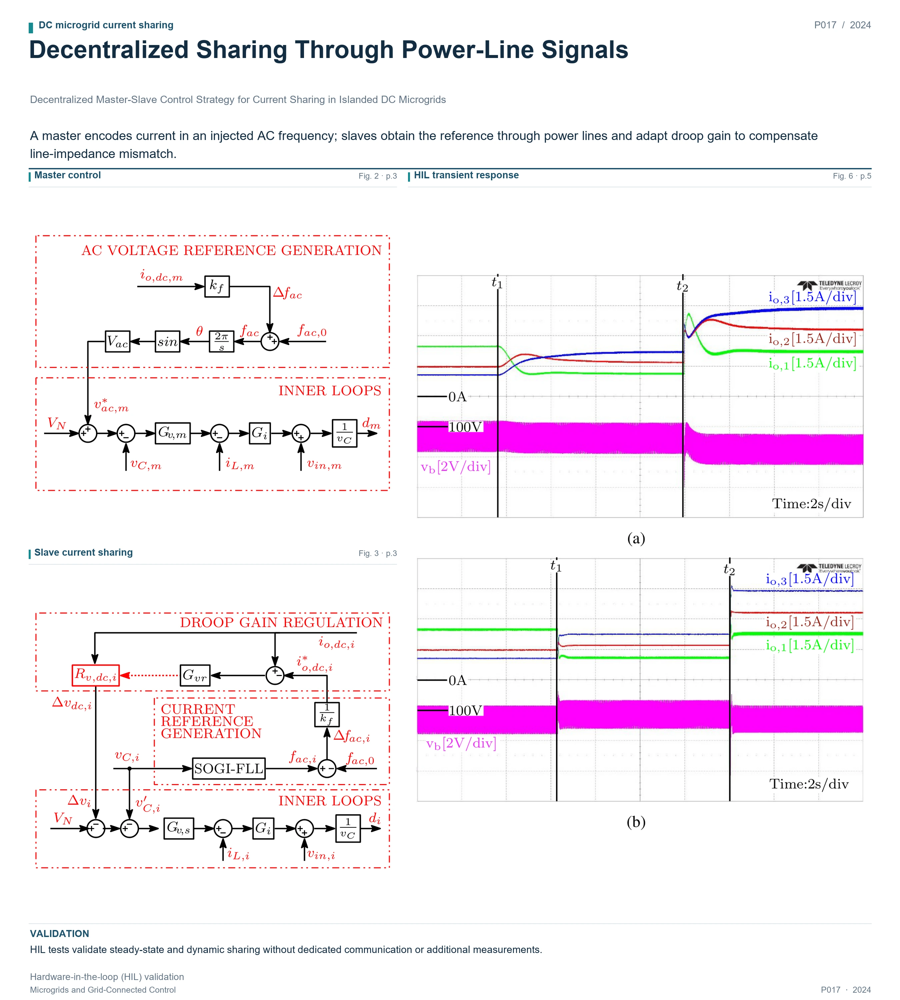

## Abstract

The microgrid is an promising solution for the integration of various renewable energy sources, easing environmental pollution. Furthermore, as the simple structure and efficient power conversion, DC microgrids have drawn growing attention. In such power system, current sharing is an essential issue for the sound operation, but it is always degraded by mismatched line impedances. To address this problem, a decentralized master-slave current sharing strategy is proposed in this paper. In the master DGU, a small AC signal is injected into the output voltage, and its frequency is exploited to carry current information. Then, slave DGUs can receive this signal to estimate the uniform output current reference signal. After that, droop gains are adaptively regulated to ensure accurate current sharing among DGUs. The proposed strategy is implemented in a decentralized way, neither a dedicated communication network nor extra measurement is required. Finally, the effectiveness of this method is verified by hardware-in-loop test results.

<figure id="research-figure" class="publication-figure">
  
</figure>
