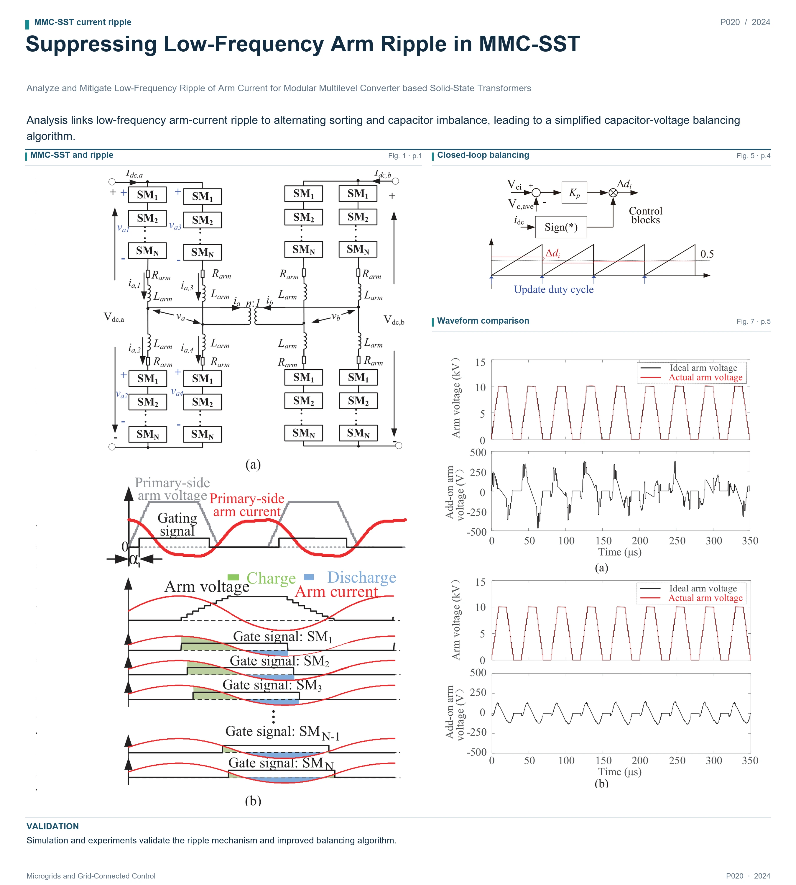

## Abstract

Recently, the modular multilevel converter (MMC) has been employed in solid state transformers (SSTs) applications, which have different modulation methods and operational principles from conventional fundamental-frequency MMCs. To maintain the stable operation of MMC-SST, an alternating sorting algorithm was proposed in an existing paper to balance capacitor voltages. As observed from experimental results, when increasing the number of submodules per arm, this method causes low-frequency ripple in arm current and ac-link voltage. The low-frequency arm current leads to the saturation of the arm inductor, resulting in high saturation current and the destruction of semiconductor devices. In addition, the mechanism and impacts of low-frequency arm current and ac-link voltage have not been comprehensively analyzed. In this paper, the mechanism of this phenomenon is analyzed. Based on the analysis, several methods are compared and evaluated for mitigating the low-frequency ripple. Then, a simplified voltage-balancing algorithm is developed. Finally, the proposed analysis and developed method are verified through simulation and experimental results.

<figure id="research-figure" class="publication-figure">
  
</figure>
