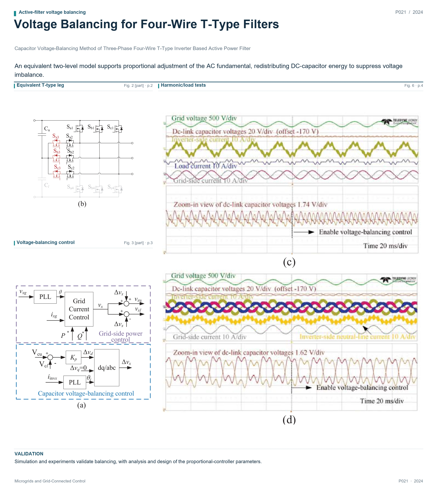

## Abstract

The T-type three-level inverter has been widely applied in grid integration system due to its salient features. In this paper, a three-phase four-wire T-type inverter is employed as an active power filter. Due to inconsistencies of capacitances and unbalanced three-phase operation, the capacitor voltages deviate. These unbalanced capacitor voltages lead to distorted grid-side currents and the instability of T-type inverter. Existing voltage-balancing algorithms inject offsets into modulation references or require complex analyses of switching states under various operating conditions, which are not suitable for three-phase four-wire T-type inverters. To simplify and improve voltage-balancing algorithms, the T-type inverter is initially equivalent to a two-level inverter based on switching states. Then, the proposed voltage-balancing adjusts the fundamental-frequency component of ac-side voltage using a proportional controller to distribute energy between the upper capacitor and low capacitor. The parameters of voltage-balancing controller are analyzed and designed in this paper. Finally, the proposed analysis and voltage-balancing algorithm are verified by experimental results.

<figure id="research-figure" class="publication-figure">
  
</figure>
