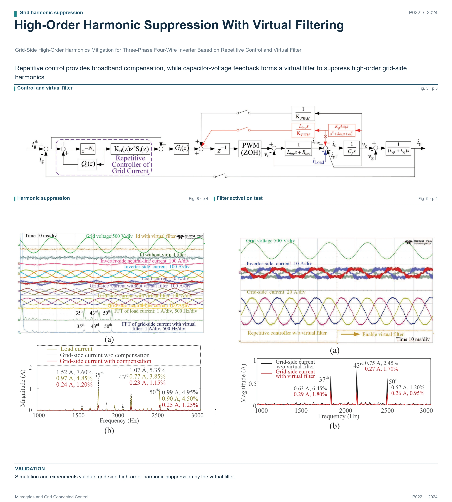

## Abstract

The increasing penetration of non-linear loads has led to a rise in power quality issues. Grid codes have established stringent requirements, particularly regarding high-order harmonics on the grid side. Shunt active power filter (SAPF) is preferable to mitigate harmonics and improve grid-side power quality. However, addressing high-order harmonics can be challenging. Multiple paralleled resonant controllers lead to heavy computational burdens. To mitigate the grid-side high-order harmonics, multiple paralleled resonant controllers are unsuitable due to heavy computational burden. An alternative solution is the repetitive controller, offering high gains at multiple frequencies. It is still challenging to design a repetitive controller with high gains over a broad frequency range while maintaining stability. Moreover, to compensate for high-order harmonics, a high control bandwidth is necessary to provide substantial gains across a wide frequency range. However, the sampling delay makes it difficult to achieve an adequate phase margin. To address this, capacitor-voltage feedforward is employed, increasing the control bandwidth and improving dynamic response. However, this approach reshapes the grid-side impedance, potentially amplifying high-order harmonics. To address this challenge, a virtual filter has been developed and implemented to suppress high-order harmonics on the grid side. The effectiveness of the proposed analysis and method has been verified by simulation and experimental results.

<figure id="research-figure" class="publication-figure">
  
</figure>
