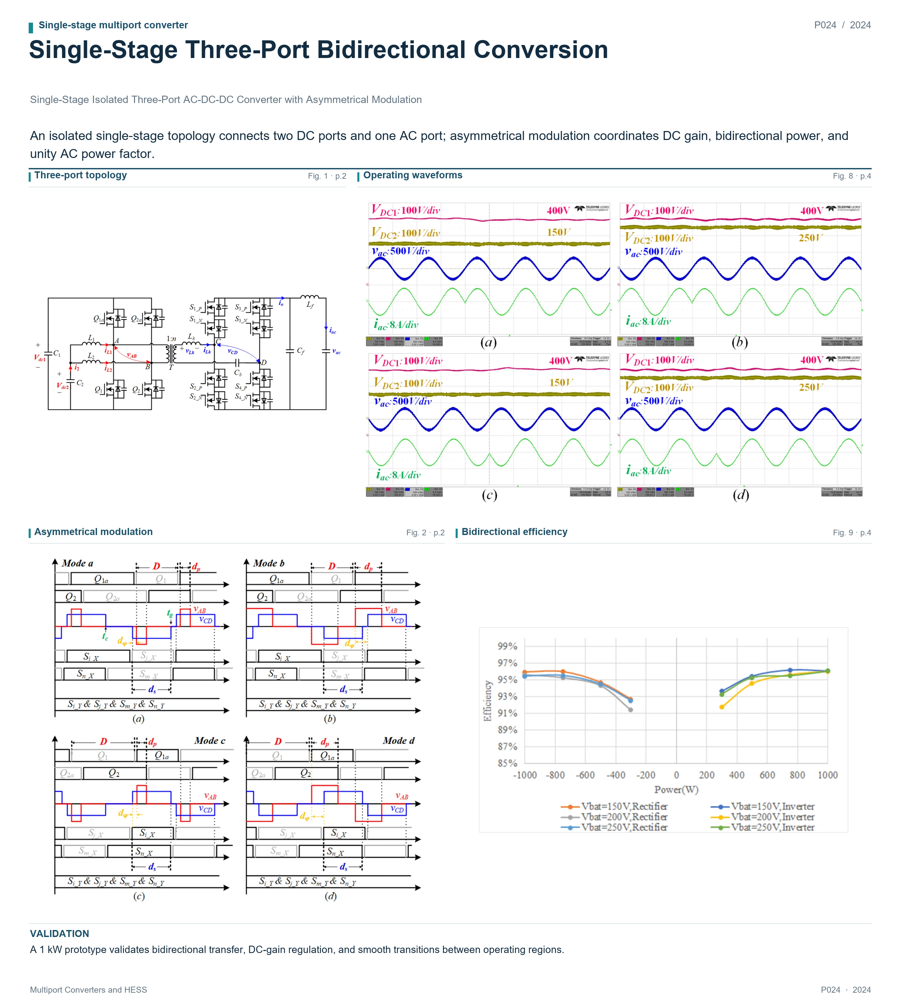

## Abstract

In this paper, a single-stage isolated three-port AC-DC-DC converter is proposed to function as an interface between two DC ports and one AC port. The introduced asymmetrical modulation scheme facilitates the voltage gain regulation between the two DC ports, enables the bidirectional power transfer among all three ports, and ensures a unity power factor in the AC port. Moreover, the optimization is performed to minimize circulating current and achieve seamless operation mode transitions. The experimental validation is carried out using a 1 kW laboratory prototype.

<figure id="research-figure" class="publication-figure">
  
</figure>
