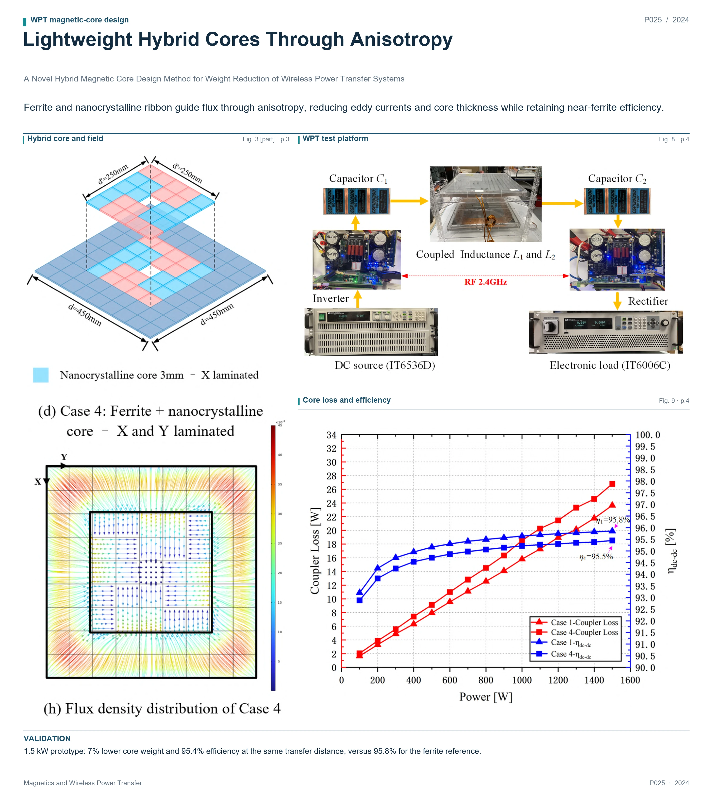

## Abstract

This paper presents a cost-effective and weight-reduced magnetic core design for electric vehicle (EV) wireless power transfer systems (WPTSs). Compared with previous research work using ferrite core or nanocrystalline core independently, this new magnetic core design makes full use of both advantages of ferrite core and nanocrystalline core. Instead of modifying the manufacturing process of nanocrystalline, a novel hybrid magnetic core design is performed to reduce the eddy current loss by utilizing the anisotropic characteristics of nanocrystalline ribbon core. The magnetic flux can be guided and uniformly distributed along the axis with high permeability. Meanwhile, the thickness of nanocrystalline core can be further reduced to improve the power density due to its high saturation flux density. As a result, it is possible to directly use the cost-effective nanocrystalline core to optimize the weight of both side magnetic cores for WPTSs. A 1.5-kW experimental prototype is built to verify the feasibility of the proposed design method. The experimental results show that the transfer efficiency of the novel magnetic core with 7% weight reduction can achieve similar efficiency 95.4% than that of ferrite core 95.8% under same trandfer distance.

<figure id="research-figure" class="publication-figure">
  
</figure>
