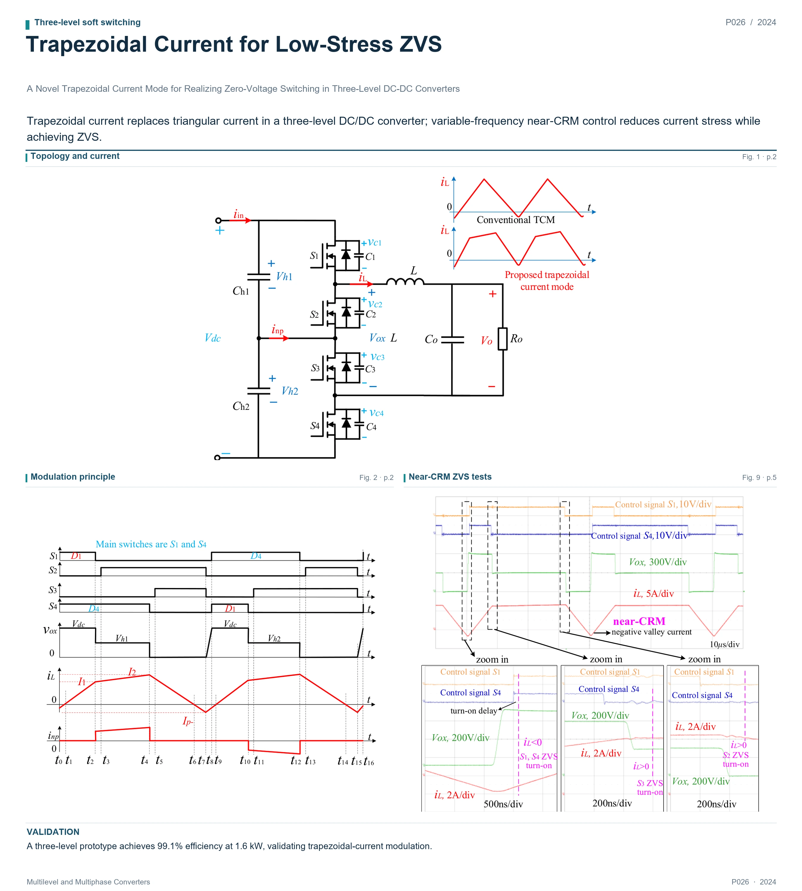

## Abstract

Triangular current mode (TCM) or near critical conduction mode (near-CRM) is popularly used in DC-DC converters to achieve zero-voltage switching (ZVS). However, it faces the huge peak current problem, more than twice the average inductor current, in the conventional modulation. To solve this problem, this paper proposes a trapezoidal current mode scheme based on near-CRM to realize the ZVS. This method can reduce the inductor peak current and realize ZVS simultaneously for three-level DC-DC converters. A typical variable switching frequency control is adopted to realize all switches in ZVS. The proposed modulation scheme is validated by a three-level DC-DC converter prototype, which achieves 99.1% efficiency at 1.6 kW.

<figure id="research-figure" class="publication-figure">
  
</figure>
