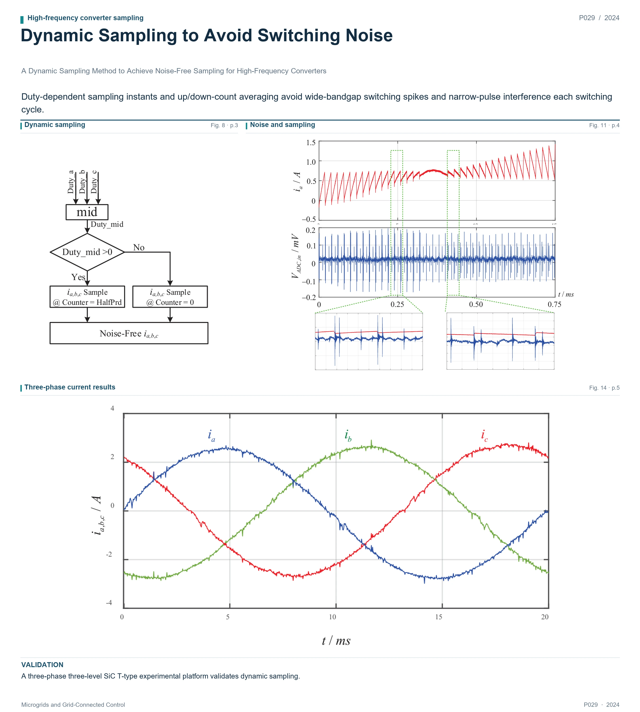

## Abstract

In current-fed closed-loop single/three-phase DC-AC converters, precise current sampling is required for better waveform quality and smaller steady-state error. However, interferences caused by switching noise pose challenges to acquiring precise averaging current value. This article presents some considerations regarding precise current sampling for high-frequency single- and three-phase DC-AC converters. Current spikes caused by spurious sampling points within narrow pulses’ ranges are analyzed in detail. The dynamic sampling method in every switching cycle is proposed to avoid the high-frequency oscillation caused by switching transitions. The proposed method is validated in the platform of three-phase/level SiC-based T-type converter.

<figure id="research-figure" class="publication-figure">
  
</figure>
