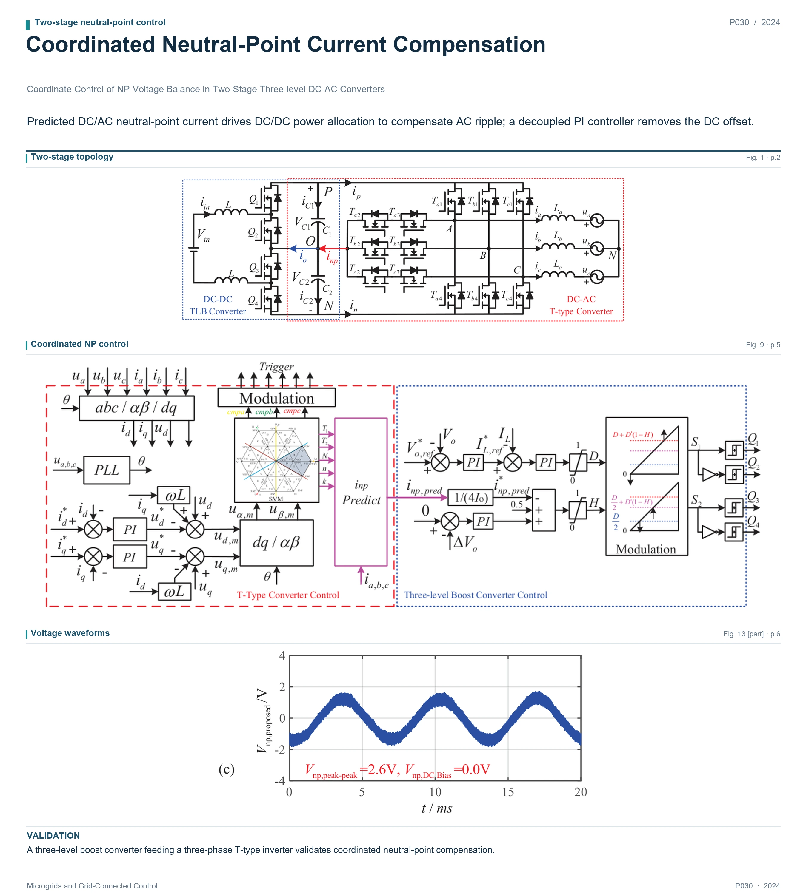

## Abstract

In this article, NP voltage coordinate control model in two-stage DC-AC converters is originally proposed. In the proposed model, the timely predicted NP current of DC-AC converters is directly used as the power allocation coefficient of DC-DC converters, which helps to compensate NP AC fluctuation. Besides, the decoupled PI control is used to overcome NP DC bias. With the balanced and less-fluctuated NP voltage, waveform quality of AC-DC converters is improved with smaller DC-link capacitance. Effectiveness of the NP voltage coordinate control model is validated by experiment based on the three-phase/level/wire T-type converter connected with a three-level boost converter.

<figure id="research-figure" class="publication-figure">
  
</figure>
