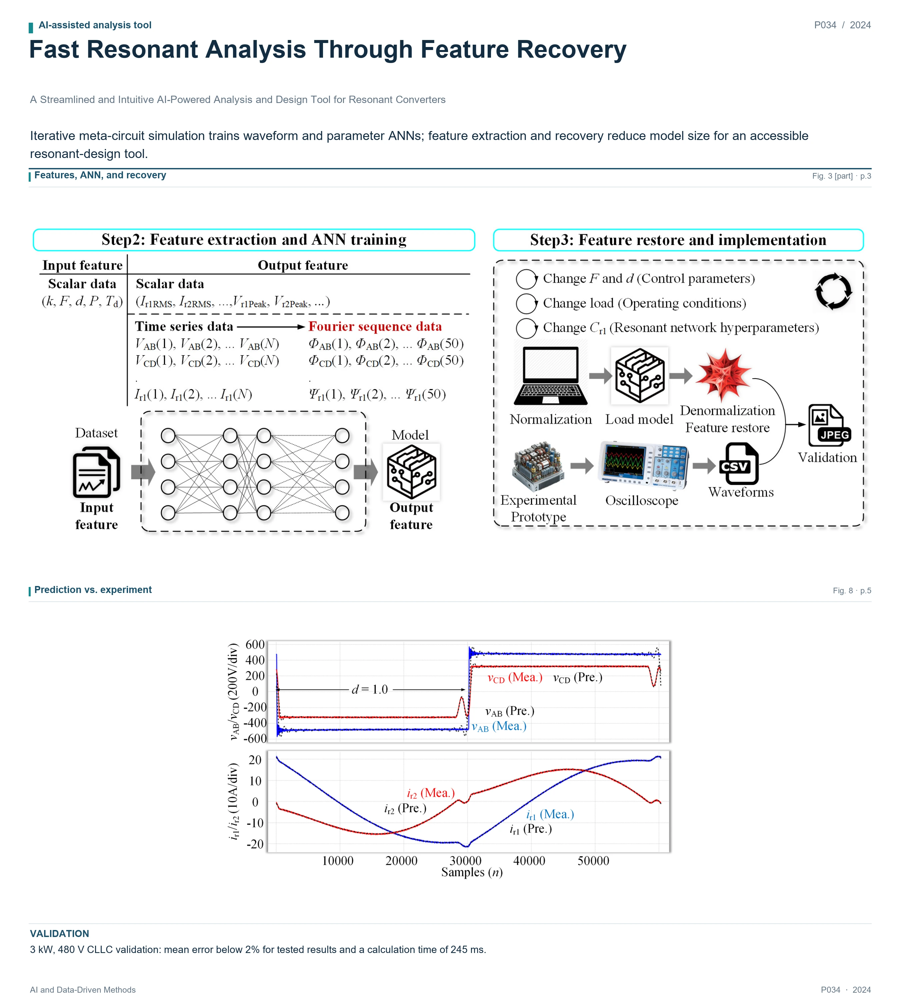

## Abstract

Resonant converters are employed in a wide array of applications; however, their analysis and design often necessitate a comprehensive grasp of their operational principles and non-linear behaviors, imposing a considerable demand on human resources. Traditional frequency domain analysis falls short in terms of accuracy, whereas time domain analysis requires sophisticated mathematical and programming expertise. Addressing this challenge, this paper introduces an advanced, yet accessible artificial intelligence (AI)-driven tool specifically designed for the analysis and design of resonant converters. This innovative approach harnesses iterative meta-circuit simulations to collect raw data, which is then processed through an artificial neural network (ANN). The ANN is trained to discern the characteristics of operating waveforms and essential parameters across varying scenarios. Feature extraction and restoration techniques are employed to enhance the ANN's size and efficiency. The efficacy of this tool is substantiated through experimental application on a 3-kW, 480-V CLLC resonant converter prototype, yielding an average error below 2% and a computation time of 245 ms. These results affirm the tool's precision and efficiency in practical applications.

<figure id="research-figure" class="publication-figure">
  
</figure>
