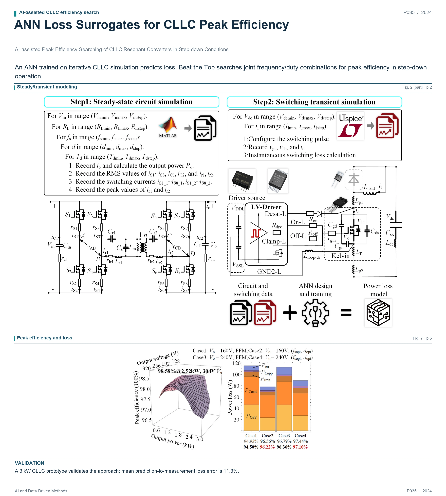

## Abstract

The CLLC resonant converter exhibits significant suitability for application in battery chargers and energy storage systems, thanks to its zero-voltage switching-on (ZVS-on) capability, which can be regulated by adjusting two control parameters: the switching frequency and the duty cycle. While pulse frequency modulation (PFM) yields high efficiency under nominal or boost conditions, in buck conditions, both control variables are adjusted to minimize power loss. Conventional strategies for diminishing power loss often depend on idealized, lossless, or overly simplistic analytical models, which can result in discrepancies between theoretical calculation and experimental results, arising from neglected or inadequately represented parameters. To address this issue, the present study introduces a methodology assisted by artificial intelligence (AI) for the precise calculation of power loss and the identification of peak efficiency points. This approach was applied to a 3 kW CLLC prototype, yielding an accurate determination of peak efficiency and an average discrepancy in power loss of 11.3% between theoretical predictions and practical observations.

<figure id="research-figure" class="publication-figure">
  
</figure>
