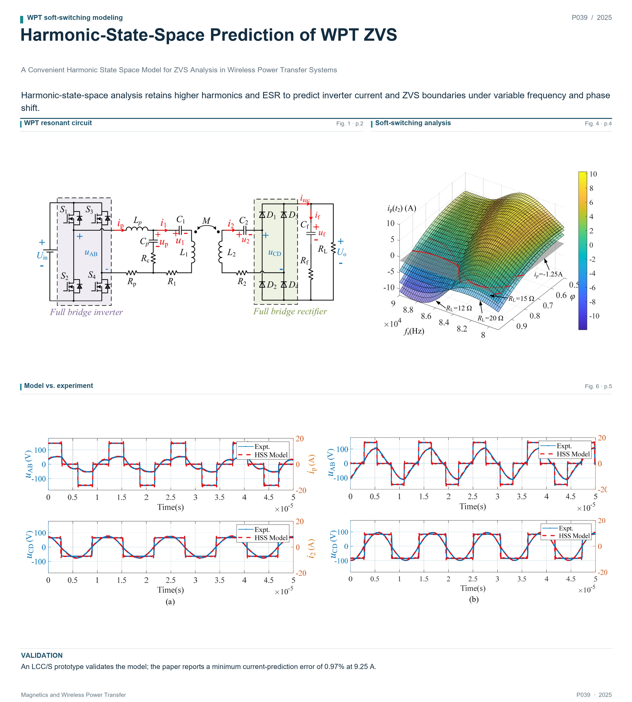

## Abstract

To improve the power transfer efficiency and reduce EMI issues of wireless power transfer systems (WPTSs), the variable frequency and phase shift control (VFPSC) strategy is widely used for its convenience and simplicity. However, the output current spectrum of the inverter under such control strategy exhibits strong nonlinear characteristics, where high-order harmonics impose severe significant impacts on system modeling and control precision. To accurately evaluate this current and achieve ZVS, traditional methods adopt a piecewise time domain model with higher-order harmonics. However, it often assumes good filter property under resonant frequency and the derivation process is burdensome for higher order topologies. In this paper, a harmonic state space (HSS) model is proposed to evaluate the inverter's output current under varying frequency conditions, which addresses full considerations to high-order harmonics and equivalent series resistance (ESR) effects. The proposed model can be further expanded to not only higher harmonic orders but also different circuit topologies conveniently. An LCC/S compensated experimental platform is built to validate the effectiveness of high-order steady state solution and the prediction of ZVS boundary is validated with a minimum error of 0.97% at 9.25A.

<figure id="research-figure" class="publication-figure">
  
</figure>
