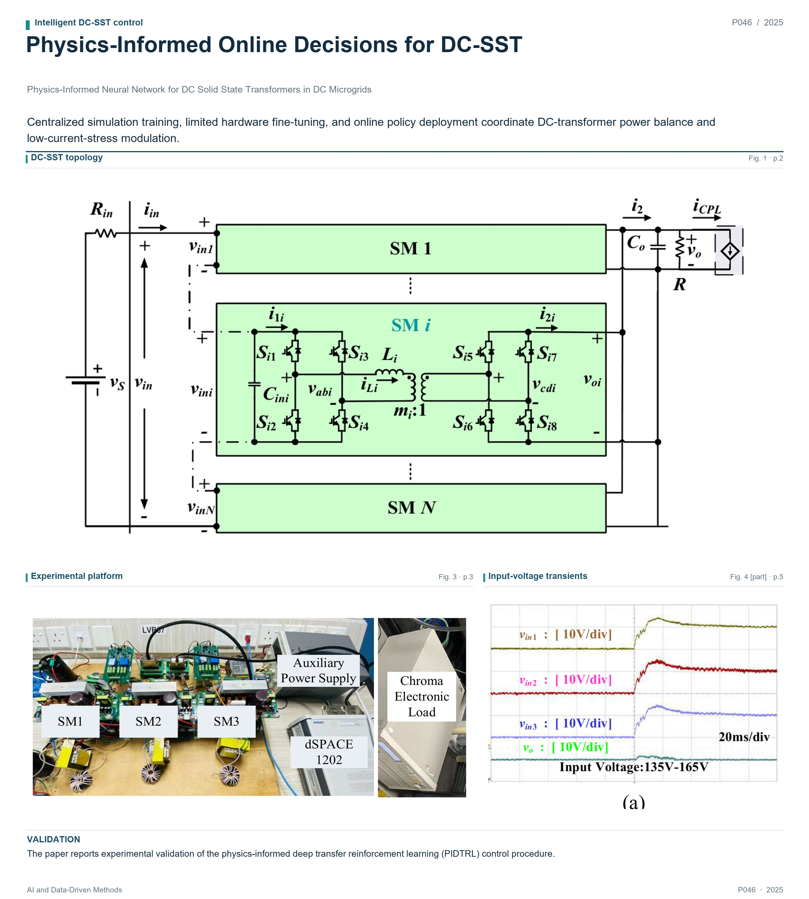

## Abstract

A physics-informed deep transfer reinforcement learning (PIDTRL) strategy is proposed for enabling advanced control and modulation of a dc solid state transformer (DCSST) in a dc microgrid. The strategy involves three stages: (i) Centralized training of deep reinforcement learning agents to balance power and reduce current stress in the DCSST; (ii) effective knowledge transfer from a Source-simulation system to a Target-experimental system using minimal experimental data; and (iii) deployment of multiple agents for online control in the DCSST. The proposed method adaptively determines optimal modulation variables (duty cycles and phase shifts) in stochastic and uncertain environments without requiring accurate model information. Experimental results validate the effectiveness of the proposed PIDTRL algorithm.

<figure id="research-figure" class="publication-figure">
  
</figure>
