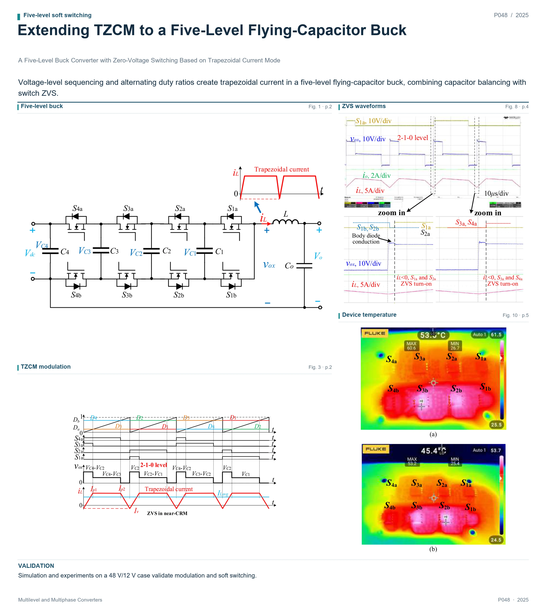

## Abstract

By leveraging the lower conduction resistance and cost advantages of low-voltage Si-MOSFETs, multilevel techniques have been extended to applications ranging from tens to hundreds of volts. However, achieving soft-switching in multilevel converters remains challenging with existing methods. This paper proposes a novel modulation strategy that enables a five-level flying capacitor buck converter to operate with zerovoltage switching (ZVS) based on the trapezoidal current mode (TZCM). The alternating duty cycle modulation is proposed to generate a trapezoidal current waveform and help the capacitor voltage balancing. Using the proposed modulation, all switches can realize ZVS soft-switching. Simulation and experimental results validate the proposed modulation method.

<figure id="research-figure" class="publication-figure">
  
</figure>
