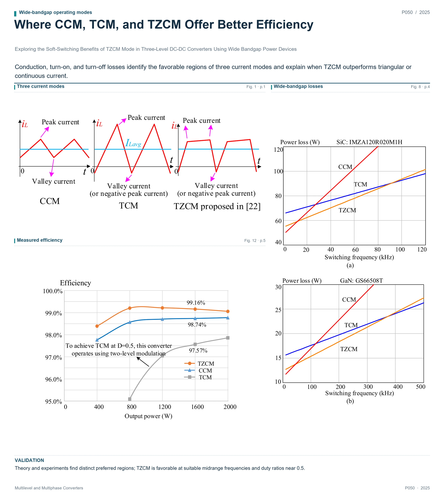

## Abstract

Wide bandgap power devices such as SiC MOSFETs and GaN HEMTs offer low conduction resistance and reduced switching losses. However, under high-frequency hard-switching operation, their switching losses remain significant. To improve efficiency, soft-switching techniques have been developed, including the well-known triangular current mode (TCM) and the emerging trapezoidal current mode (TZCM). The two modes enable zero-voltage switching (ZVS) without requiring additional auxiliary components, and effectively eliminate turn-on losses and body diode reverse recovery losses. But, a detailed comparison of their soft-switching benefits has not yet been conducted. This paper aims to clarify the respective advantages and application boundaries of continuous conduction mode (CCM), TCM, and TZCM. Through theoretical analysis and comparison, the advantageous operating ranges of the three modes are identified. Experimental results confirm that each operating mode has its own advantageous operating range.

<figure id="research-figure" class="publication-figure">
  
</figure>
