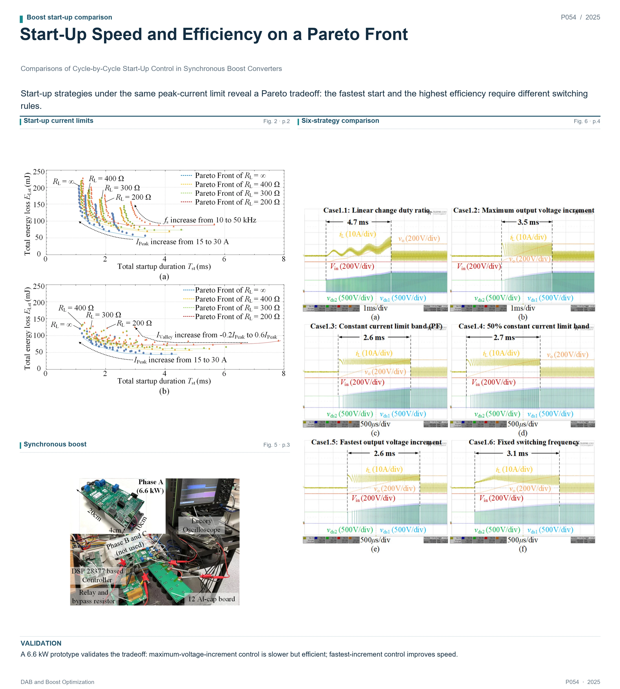

## Abstract

Efficient start-up for synchronous boost converters is vital to minimize inrush currents, reduce component stress, and improve power conversion performance. This paper compares start-up methods under a predefined peak current condition. The Pareto front reveals that the maximum output voltage increment method is the most efficient but slowest, while the constant current limit band and fastest voltage increment methods are quickest, with the latter offering better efficiency. The fixed switching frequency method is slower and less efficient. Experimental results on a 6.6 kW prototype confirm the theoretical analysis.

<figure id="research-figure" class="publication-figure">
  
</figure>
