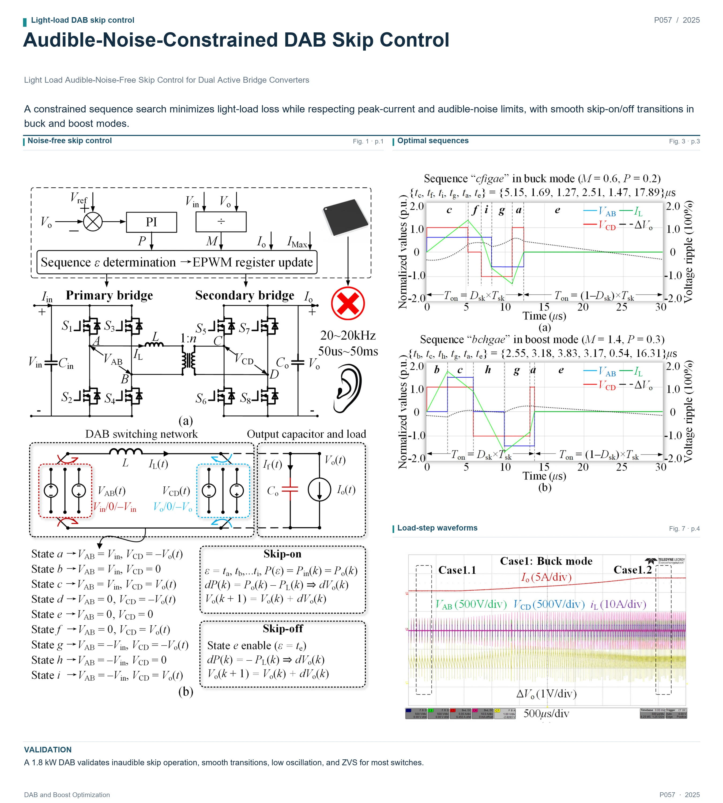

## Abstract

This paper explores audible-noise-free skip control for dual active bridge (DAB) converters at light load condition. Switching sequences for power loss minimization are derived using a constrained search algorithm, considering audible noise and maximum inductor current limits. Experimental results from a 1.8-kW DAB prototype show the method eliminates audible noise in both buck and boost modes, with smooth skip-on/off transitions and minimal oscillations during steady-state and dynamic operation. Zero voltage switching (ZVS) is achieved for most power switches, minimizing switching loss and ensuring high efficiency.

<figure id="research-figure" class="publication-figure">
  
</figure>
