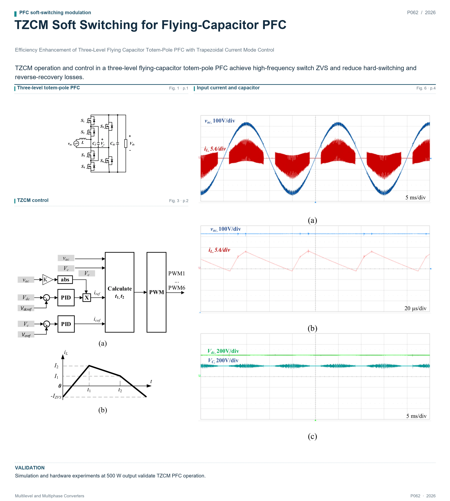

## Abstract

The three-level flying capacitor totem-pole power factor correction (3L-FC-TP-PFC) converter is a multilevel PFC topology that offers significant benefits, including low voltage stress on the high-frequency leg and a reduced filter size. When operating in continuous conduction mode (CCM), the converter can achieve high efficiency; however, CCM operation suffers from inherent drawbacks, such as switching and reverse-recovery losses, which can limit overall performance. To address these challenges, this paper presents the application of trapezoidal current mode (TZCM) in 3L-FC-TP-PFC converters. By employing TZCM, zero-voltage switching (ZVS) is achieved for all high-frequency switches, reducing switching losses and improving overall efficiency. The operating principles and control techniques required to implement TZCM in the PFC are presented in detail. Moreover, to validate the effectiveness and feasibility of the proposed approach, both simulation and experimental tests are conducted at a 500 W output power level.

<figure id="research-figure" class="publication-figure">
  
</figure>
