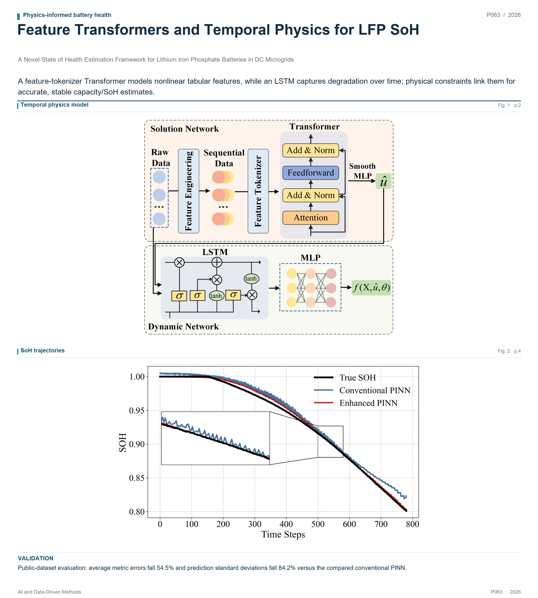

## Abstract

With the rapid transition toward renewable energy systems, lithium iron phosphate (LFP) batteries have become critical energy storage components in direct current microgrids, where accurate capacity estimation is essential for ensuring system reliability and operational safety. However, practical LFP battery data in microgrids are inherently heterogeneous and exhibit complex nonlinear degradation behaviors, while the pronounced long-term temporal dynamics further challenge the modeling of degradation processes. To address these issues, this paper proposes a feature-enhanced attentional and temporal physics-informed neural network (PINN) for LFP battery capacity estimation. A feature tokenizer transformer is employed to capture complex nonlinear dependencies within tabular features, and a long short-term memory-based physical dynamics network is incorporated to explicitly model temporal degradation evolution and enforce physical consistency through a physics-informed constraint mechanism. Experimental results demonstrate that the proposed PINN achieves a comprehensive leap in both accuracy and stability compared to conventional PINN architectures.

<figure id="research-figure" class="publication-figure">
  
</figure>
